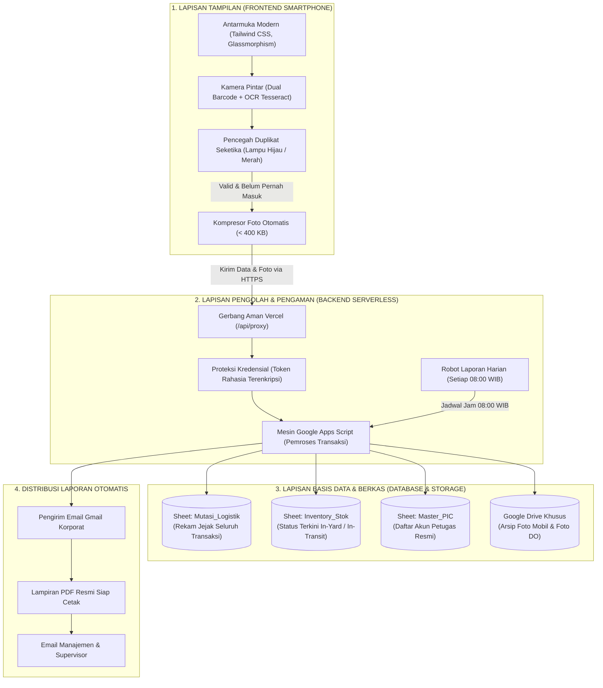

# 🚗 Dokumen Spesifikasi Produk (PRD) & Panduan Sistem
## Sistem Management StockYard Kendaraan (Astra Daihatsu DSO Lampung)

> **Klasifikasi:** Dokumen Resmi Spesifikasi Produk, Arsitektur Sistem & Operasional Bisnis  
> **Sasaran Pembaca:** Manajemen, Kepala Operasional Pool, Supervisor Logistik, Klien Bisnis, & Tim Pengembang  
> **Status:** Siap Operasional (*Production-Ready*)  
> **Lokasi Implementasi:** Pool StockYard Sentra Lampung (Astra Daihatsu DSO Lampung)  

---

## 1. Ringkasan Eksekutif (Executive Summary)

### 1.1 Latar Belakang & Tujuan
Operasional pengelolaan dan penataan unit kendaraan di area pool logistik dan StockYard Astra Daihatsu DSO Lampung membutuhkan kecepatan, ketelitian mutlak, dan pencatatan fisik yang dapat dipertanggungjawabkan (*audit-ready*). 

Sistem **Management StockYard (Astra Daihatsu DSO Lampung)** dirancang khusus untuk memodernisasi proses pencatatan manual berbasis kertas atau spreadsheet mandiri menjadi **sistem digital terintegrasi** yang mencakup:
1. **Frontend Mobile-First**: Aplikasi pemindai cepat berbasis web di smartphone petugas lapangan.
2. **Backend Serverless & Cloud Processor**: Pemroses transaksi mutasi, kompresi berkas, dan robot otomatisasi laporan.
3. **Database & Cloud Storage Transparan**: Basis data Google Spreadsheet yang mudah dipantau serta brankas foto Google Drive resmi perusahaan.

### 1.2 Nilai Manfaat Utama bagi Manajemen & Klien
* **Nol Risiko Data Ganda (*Zero Duplicate Entry*)**: Sistem secara cerdas memblokir pemindaian berulang untuk unit yang sama, memastikan data inventaris di lapangan selalu 100% akurat sesuai kondisi fisik sebenarnya.
* **Proses Masuk/Keluar Super Cepat (< 20 Detik per Unit)**: Petugas lapangan cukup mengarahkan kamera smartphone ke stiker kaca mobil tanpa perlu mengetik manual 17 digit nomor rangka yang rawan salah ketik.
* **Bukti Fisik Lengkap & Otomatis Terarsip**: Setiap mutasi unit wajib menyertakan foto fisik mobil dan foto surat jalan (DO) yang otomatis tersimpan rapi di Google Drive perusahaan.
* **Transparansi Tanpa Repot**: Laporan mutasi harian berformat PDF resmi terkirim otomatis ke email manajemen setiap pagi pukul **08:00 WIB**, tanpa perlu ada admin yang lembur merekap manual.
* **Akses Mudah Tanpa Instalasi Rumit**: Aplikasi dapat langsung dibuka melalui browser di smartphone Android maupun iPhone tanpa perlu install aplikasi berat dari toko aplikasi.

---

## 2. Perbandingan: Cara Kerja Konvensional vs. Sistem Baru

| Aspek Operasional | Cara Konvensional (Sebelumnya) | Menggunakan Sistem Management StockYard |
| :--- | :--- | :--- |
| **Pencatatan Nomor Rangka (VIN)** | Dicatat tangan di kertas surat jalan atau diketik satu per satu di Excel. Sering terjadi salah baca angka `0` dan huruf `O`, atau `1` dan `I`. | **Pemindaian Otomatis via Kamera Smartphone**. Sistem langsung mengekstrak nomor rangka 17 digit dan nomor mesin dengan verifikasi standar ISO otomotif. |
| **Menghadapi Stiker Kaca Bertumpuk** | Petugas bingung karena stiker kaca Daihatsu memiliki 5-7 barcode bertumpuk (nomor vendor, barcode DO, nomor sasis, barcode suku cadang). | **Filter Cerdas Otomatis**. Kamera pintar langsung menyaring dan memilih nomor rangka berawalan `MHK` dan mengabaikan kode pabrik yang tidak diperlukan. |
| **Pencegahan Unit Terinput Dua Kali** | Baru ketahuan saat ada selisih stok fisik bulanan (*stock opname*). | **Pencegahan Real-Time di Lapangan**. Jika unit sudah tercatat, aplikasi langsung berbunyi peringatan, bergetar panjang, dan layar memblokir tombol simpan. |
| **Arsip Bukti Foto Fisik & Surat Jalan** | Foto tersimpan di galeri WhatsApp petugas lapangan, sering terhapus, buram, atau tercecer. | **Terunggah Otomatis ke Google Drive Resmi**. Foto langsung terhubung dengan nomor rangka kendaraan dan dapat dibuka kapan saja melalui link di laporan. |
| **Laporan Harian ke Pihak Manajemen** | Admin pool harus mengetik rekap manual setiap sore atau pagi hari, rentan terlambat. | **Otomatis Kirim PDF ke Email Jam 08:00 WIB**. Sistem bekerja mandiri merekap mutasi 24 jam terakhir dan melampirkannya dalam format PDF siap cetak. |

---

## 3. Arsitektur Tiga Lapis (Frontend, Backend, & Database)

Sistem dibangun dengan arsitektur 3-lapis modern yang memisahkan tampilan pengguna, lapisan keamanan pengolah data, dan tempat penyimpanan permanen:

---

## 4. Rincian Teknis Setiap Lapisan Sistem

### 4.1 Lapisan Antarmuka Pengguna (Frontend Layer)
Frontend adalah aplikasi web yang diakses langsung oleh petugas lapangan melalui browser smartphone:
1. **Desain Mobile-First & Responsif**:
   - Dibuat dengan Tailwind CSS modern berkonsep *glassmorphism* yang nyaman di mata petugas baik di bawah terik matahari siang maupun penerangan malam hari.
   - Tidak memerlukan instalasi toko aplikasi (hemat memori ponsel petugas).
2. **Kamera Pemindai Ganda (Dual-Engine Smart Scanner)**:
   - **Mode Barcode Otomatis**: Membaca barcode stiker secara langsung dalam hitungan milidetik.
   - **Mode Baca Teks Stiker (OCR Tesseract)**: Jika barcode rusak, robek, atau kaca depan terkena silau matahari, petugas cukup menekan satu tombol untuk memotret stiker. Sistem membaca teks cetak nomor sasis dan mesin secara otomatis. Bisa juga memilih foto stiker dari galeri ponsel.
   - **Penyaring Cerdas Multi-Barcode**: Secara otomatis memisahkan nomor rangka `MHK...`, nomor mesin, dan nomor DO dari 7 baris barcode yang bertumpuk pada stiker kaca depan Daihatsu.
3. **Sistem Sensorik Anti-Duplikat**:
   - Menghubungkan pemeriksaan data lokal seketika. Jika nomor rangka sudah pernah tercatat, layar menyala **MERAH**, ponsel bergetar panjang, suara peringatan berbunyi, dan tombol submit dinonaktifkan. Jika valid, layar menyala **HIJAU** dengan bunyi bip sukses.
4. **Kompresi Gambar Otomatis di HP Petugas**:
   - Foto mobil dan foto surat jalan beresolusi tinggi (4–8 MB) otomatis dikompresi di dalam browser ponsel menjadi < 400 KB berformat JPEG teroptimasi sebelum dikirim. Proses ini menghemat kuota internet lapangan dan memastikan pengiriman hanya membutuhkan waktu 1-2 detik.
5. **Indikator Konektivitas Real-Time**:
   - Memiliki indikator status koneksi yang memberi tahu petugas secara langsung bahwa sistem terhubung dengan server dan siap mengirimkan notifikasi.

---

### 4.2 Lapisan Pemroses & Pengaman (Backend Layer)
Backend bertugas memproses data, menjaga keamanan data korporat, serta menjalankan otomasi:
1. **Gerbang Pengaman Serverless (Vercel Secure Reverse Proxy)**:
   - Bertindak sebagai benteng terdepan yang menerima perintah dari ponsel petugas di `/api/proxy`.
   - **Tujuan Keamanan**: Menyembunyikan alamat asli database Google Spreadsheet dan token otentikasi agar tidak bisa dilihat atau diretas oleh pihak luar melalui fitur inspeksi browser (*DevTools*).
2. **Mesin Pemroses Transaksi (Google Apps Script Engine)**:
   - Berjalan di infrastruktur awan Google yang sangat stabil dengan uptime 99.9%.
   - Menerima paket data mutasi dari proxy, memeriksa validitas kunci otentikasi rahasia (*API Secret Token*).
   - Mengubah data foto Base64 menjadi berkas gambar murni (`.jpg`) dan meletakkannya langsung di Google Drive.
   - Menuliskan data mutasi baru ke baris Google Spreadsheet secara *real-time* dan memperbarui status unit di tabel stok.
3. **Robot Pembuat Laporan Otomatis (Time-driven Scheduled Cron)**:
   - Sistem robotik yang aktif setiap hari tepat pukul **08:00 WIB**.
   - Menghimpun seluruh pergerakan unit dalam 24 jam terakhir.
   - Mengompilasi data ke dalam template laporan resmi Astra Daihatsu berformat PDF.
   - Mengirimkan email resmi ke jajaran manajemen secara terjadwal tanpa campur tangan manusia.

---

### 4.3 Lapisan Basis Data & Penyimpanan Berkas (Database & Storage Layer)
Sistem menggunakan ekosistem Google Workspace resmi yang sangat transparan dan mudah diaudit oleh manajemen:

#### A. Lembar Kerja 1: `Mutasi_Logistik` (Buku Besar Rekam Jejak)
Mencatat seluruh riwayat mutasi unit dari waktu ke waktu secara permanen:

| Kolom | Nama Kolom Spreadsheet | Tipe Data | Contoh Isi Data | Penjelasan Fungsi Data |
| :---: | :--- | :--- | :--- | :--- |
| **A** | `timestamp` | Tanggal & Jam | `2026-10-21 08:30:15` | Waktu persis saat mutasi dicatat di pool |
| **B** | `mutation_id` | Teks Unik | `MUT-20261021-0012` | Nomor urut kode transaksi mutasi |
| **C** | `vin_number` | Teks (17 Karakter) | `MHKP3FA1JTK137533` | Nomor Rangka resmi kendaraan (Kunci Utama) |
| **D** | `engine_number` | Teks | `2NR4F82393` | Nomor Mesin kendaraan |
| **E** | `car_model` | Teks Pilihan | `Gran Max Pick Up` | Varian model dari 13 katalog resmi Daihatsu |
| **F** | `mutation_type` | Teks Pilihan | `Unit Masuk` / `Unit Keluar` | Jenis pergerakan kendaraan di area pool |
| **G** | `pic_name` | Teks | `Syafira Fira` | Nama petugas resmi yang melakukan serah terima |
| **H** | `do_number` | Teks Angka | `2260411667` | Nomor Surat Jalan / Delivery Order resmi |
| **I** | `unit_photo_url` | Tautan URL | `https://drive.google.com/uc?id=...` | Tautan langsung untuk membuka foto fisik mobil |
| **J** | `doc_photo_url` | Tautan URL | `https://drive.google.com/uc?id=...` | Tautan langsung untuk membuka foto surat jalan DO |
| **K** | `keterangan` | Teks Catatan | `Kondisi mulus, spion lengkap, baret halus bemper` | Catatan kondisi fisik kendaraan saat serah terima |

#### B. Lembar Kerja 2: `Inventory_Stok` (Status Posisi Terkini Unit)
Menampilkan posisi setiap kendaraan saat ini di StockYard:

| Kolom | Nama Kolom Spreadsheet | Tipe Data | Contoh Isi Data | Penjelasan Fungsi Data |
| :---: | :--- | :--- | :--- | :--- |
| **A** | `vin_number` | Teks (17 Karakter) | `MHKP3FA1JTK137533` | Nomor Rangka kendaraan |
| **B** | `engine_number` | Teks | `2NR4F82393` | Nomor Mesin kendaraan |
| **C** | `car_model` | Teks | `Gran Max Pick Up` | Model kendaraan |
| **D** | `current_status` | Status | `IN_YARD` / `IN_TRANSIT` | **IN_YARD** (Ada di pool) atau **IN_TRANSIT** (Keluar/Jalan) |
| **E** | `last_mutation_type` | Teks | `Unit Masuk` | Jenis mutasi terakhir yang dialami unit |
| **F** | `last_updated` | Tanggal & Jam | `2026-10-21 08:30:15` | Waktu pembaruan status terakhir |
| **G** | `pic_in_charge` | Teks | `Syafira Fira` | Petugas penanggung jawab terakhir |

#### C. Lembar Kerja 3: `Master_PIC` (Daftar Identitas Petugas)
Mencatat akun petugas lapangan yang memiliki izin memproses unit:

| Kolom | Nama Kolom | Tipe Data | Contoh Isi | Penjelasan |
| :---: | :--- | :--- | :--- | :--- |
| **A** | `pic_id` | Teks | `PIC-001` | Kode identitas petugas |
| **B** | `username` | Teks | `syafira` | Nama akun petugas |
| **C** | `full_name` | Teks | `Syafira Fira` | Nama lengkap resmi petugas lapangan |
| **D** | `email` | Teks | `admin.logistics@daihatsu.co.id` | Email koordinasi resmi |
| **E** | `role` | Pilihan | `YARD_OFFICER` / `SUPERVISOR` | Tingkat hak akses petugas |

#### D. Google Drive Cloud Storage (Arsip Bukti Foto)
* Folder khusus terpusat di Google Drive perusahaan yang diatur agar rapi dan tidak bercampur dengan file lain.
* Sistem otomatis menamai file dengan standar otomotif:
  - Foto Unit: `UNIT_[NomorRangka]_[Waktu].jpg`
  - Foto Dokumen DO: `DO_[NomorRangka]_[Waktu].jpg`
* Foto dapat dilihat kapan saja dengan mengeklik tautan pada tabel spreadsheet atau pada tabel rekap PDF.

---

## 5. Alur Kerja Operasional Petugas Lapangan (SOP Ringkas)

Berikut adalah tahapan praktis penggunaan aplikasi oleh petugas di pool logistik:

---

## 6. Katalog 13 Model Resmi Kendaraan Daihatsu

Sistem telah diprogram mengenali dan mengelompokkan 13 varian model resmi kendaraan Daihatsu yang beredar di pasar:

| No | Nama Model Kendaraan | Kategori Segmen | Karakteristik Penggunaan Lapangan |
| :-: | :--- | :--- | :--- |
| **1** | **All New Ayla** | Hatchback / LCGC | Penempatan di area parkir city car / compact yard |
| **2** | **New Sigra** | MPV 7-Seater / LCGC | Unit volume tinggi, fast-moving distribusi keluarga |
| **3** | **All New Xenia** | MPV Keluarga | Mobil keluarga multifungsi, perputaran unit tinggi |
| **4** | **New Terios** | Compact SUV | Unit petualang / medium ground clearance |
| **5** | **Terios Special Edition (SE)**| Compact SUV Khusus | Unit edisi terbatas dengan aksesoris khusus |
| **6** | **New Rocky** | Compact Crossover | Unit SUV turbo compact modern |
| **7** | **Rocky ADS** | Crossover Sporty | Edisi sporty dengan paket bodykit Astra Daihatsu Styling |
| **8** | **Rocky Hybrid** | Crossover Elektrik/Hybrid | Penanganan khusus unit berteknologi baterai/hybrid |
| **9** | **New Sirion** | City Car Premium | Hatchback premium perkotaan |
| **10**| **Gran Max Pick Up** | Niaga Komersial Ringan | Armada angkutan barang terbuka, frekuensi mutasi tinggi |
| **11**| **Gran Max Blind Van** | Niaga Kargo Tertutup | Armada tertutup untuk ekspedisi dan kargo logistik |
| **12**| **Gran Max Minibus** | Niaga Penumpang / Travel | Armada angkutan penumpang umum / travel |
| **13**| **Daihatsu Luxio** | Minibus Eksekutif | Kendaraan komersial premium berkapasitas lega |

---

## 7. Keamanan Sistem & Perlindungan Privasi Data

Meskipun sistem ini sangat mudah digunakan di lapangan, keamanan data tingkat korporat tetap menjadi prioritas utama:

1. **Kode Rahasia Tidak Terekspos ke Publik**:
   - Sistem backend menggunakan mekanisme serverless yang aman. Kredensial rahasia, token, dan skrip internal Google dilindungi di balik pintu gerbang terenkripsi (*Reverse Proxy*).
   - Berkas skrip backend tidak pernah diletakkan di tempat terbuka yang dapat diakses oleh pihak luar.
2. **Akses Kamera Aman (HTTPS Terenkripsi)**:
   - Seluruh komunikasi data dari browser petugas ke database terlindungi enkripsi standar SSL/TLS 256-bit.
3. **Pemberian Hak Akses Terbatas (Role-Based Access)**:
   - Petugas lapangan hanya memiliki akses untuk memindai dan memasukkan data.
   - Pihak manajemen dan supervisor memiliki akses penuh untuk meninjau spreadsheet, folder foto Google Drive, dan menerima email PDF harian.

---

## 8. Target Kinerja & Jaminan Mutu (SLA & Key Performance Indicators)

| Indikator Kinerja (KPI) | Target Standar | Manfaat Nyata di Lapangan |
| :--- | :---: | :--- |
| **Tingkat Kesalahan Data Ganda (*Duplicate Rate*)** | **0% (Nol Kesalahan)** | Tidak akan ada unit yang terhitung ganda dalam laporan stok fisik. |
| **Kecepatan Input per Kendaraan** | **< 20 Detik** | Petugas dapat menyelesaikan input 1 mobil lengkap dengan 2 foto dalam kurang dari setengah menit. |
| **Akurasi Pemindaian Nomor Rangka** | **> 98%** | Kamera mengenali nomor rangka dan nomor mesin tanpa perlu input manual. |
| **Ketersediaan Bukti Foto Fisik** | **100% Wajib** | Tidak ada kendaraan yang masuk atau keluar tanpa memiliki foto mobil dan foto surat jalan. |
| **Ketepatan Waktu Laporan Harian** | **Tepat Pukul 08:00 WIB** | Manajemen selalu menerima laporan di meja kerja setiap pagi secara otomatis. |

---

## 9. Pertanyaan yang Sering Diajukan (FAQ) untuk Tim Lapangan

> [!NOTE]
> **T: Bagaimana jika stiker kaca depan mobil terkena pantulan sinar matahari yang silau atau kotor?**  
> **J:** Petugas cukup beralih ke tombol **"🔤 Baca Teks Stiker (OCR)"**. Sistem secara otomatis akan mempertajam kontras gambar dan membaca teks nomor rangka di bawah garis barcode. Petugas juga dapat memotret stiker terlebih dahulu, lalu memilih fotonya dari galeri smartphone.

> [!TIP]
> **T: Apakah petugas lapangan perlu membuat akun Google baru untuk menggunakan aplikasi ini?**  
> **J:** Tidak perlu. Aplikasi berbasis web ini dapat langsung diakses melalui tautan web di browser smartphone (Chrome atau Safari). Petugas cukup memilih nama mereka saat melakukan verifikasi mutasi.

> [!IMPORTANT]
> **T: Jika jaringan internet di pool tiba-tiba lambat atau terputus sementara, apakah data hilang?**  
> **J:** Sistem dirancang memiliki memori cadangan lokal sementara di browser smartphone (*Local Storage*). Jika koneksi terputus saat proses pengiriman, petugas akan diberi tahu melalui notifikasi peringatan agar dapat mencoba kembali saat sinyal kembali stabil tanpa harus memindai ulang dari awal.

---

## 10. Pengesahan & Kontak Layanan

Dokumen spesifikasi produk ini disusun untuk menjadi acuan bersama antara tim pengembang, pihak manajemen logistik, dan pengguna operasional StockYard Astra Daihatsu DSO Lampung.

* **Penanggung Jawab Sistem:** Tim Sistem Informasi & Manajemen StockYard Astra Daihatsu DSO Lampung  
* **Email Dukungan Resmi:** `admin.logistics@daihatsu.co.id`  
* **Pusat Operasional:** Pool StockYard Sentra Lampung (Astra Daihatsu DSO Lampung)  
* **Status Dokumen:** Disetujui untuk Operasional Aktif (Versi 2.4 - Terverifikasi)  
