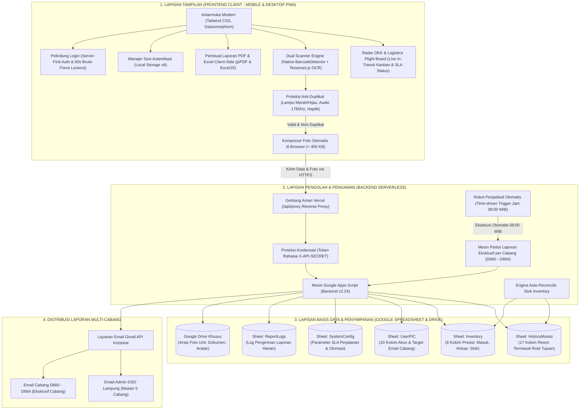
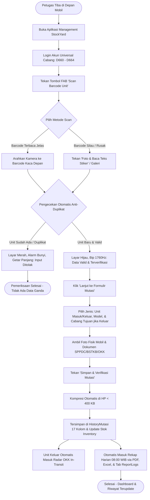

# 🚗 Dokumen Spesifikasi Produk (PRD) & Panduan Sistem Lengkap
## Sistem Management StockYard Kendaraan (Astra Daihatsu DSO Lampung)

> **Klasifikasi:** Dokumen Resmi Spesifikasi Produk, Arsitektur Sistem, Katalog Fitur Menyeluruh & Operasional Bisnis  
> **Sasaran Pembaca:** Manajemen Astra Daihatsu, Kepala Wilayah (DSO Lampung), Admin Head / Branch Manager (ADH/BM), Supervisor Logistik, Tim Security On-Duty Cabang (D660–D664), & Tim Pengembang  
> **Status Dokumen:** Siap Operasional (*Production-Ready Enterprise Edition — Versi 2.11 Terverifikasi*)  
> **Cakupan Wilayah:** Sentra Distribusi & Manajemen StockYard Area Lampung (DSO Lampung & 5 Cabang Resmi: D660, D661, D662, D663, D664)  

---

## 1. Ringkasan Eksekutif (Executive Summary)

### 1.1 Latar Belakang & Tujuan Transformasi
Operasional pengelolaan, pengawasan, dan mutasi unit kendaraan di area pool logistik dan StockYard Astra Daihatsu DSO Lampung membutuhkan kecepatan pemrosesan tinggi, akurasi data mutlak, dan pencatatan fisik yang dapat dipertanggungjawabkan secara transparan (*audit-ready*). 

Sistem **Management StockYard (Astra Daihatsu DSO Lampung)** mentransformasi operasional konvensional berbasis kertas dan spreadsheet menjadi **ekosistem aplikasi web enterprise terpadu (Mobile & Desktop PWA)** yang terhubung secara realtime dengan infrastruktur Google Workspace (Google Sheets, Drive, Gmail API) melalui serverless reverse proxy Vercel berkeamanan tinggi.

### 1.2 Nilai Manfaat Utama bagi Manajemen & Operasional Cabang
* **Arsitektur Multi-Cabang Resmi (DSO Lampung & 5 Cabang D660–D664)**: Pengawasan sentral oleh Admin DSO Lampung sekaligus isolasi data (*data isolation*) untuk petugas Security cabang sesuai lokasi penugasan resmi.
* **Akun Security Universal per Cabang (Bebas NPK)**: Kredensial login cabang bersifat universal untuk setiap regu *Security on-duty*, sehingga pergantian giliran jaga berjalan lancar tanpa kendala birokrasi pergantian NPK.
* **Radar OKK & Logistics Flight Board Realtime**: Visualisasi status armada yang sedang bergerak (*In-Transit / OTW*) antar cabang, estimasi waktu tempuh (ETA), status ketepatan waktu (*On-Track* vs *Melebihi Estimasi*), rute asal ➔ tujuan, serta durasi perjalanan live.
* **Penyederhanaan Form & Kecepatan Mutasi (< 15 Detik per Unit)**: Peniadaan input nama driver pihak ketiga menghilangkan antrean gerbang pool. Petugas cukup fokus memindai VIN, memilih cabang tujuan, dan memotret fisik unit serta dokumen resmi (SPPDC/BSTKB/OKK).
* **Nol Risiko Data Ganda (*Zero Duplicate Entry*)**: Sistem memblokir pemindaian berulang untuk unit yang sama melalui alarm multi-sensor seketika di lapangan (audio 1760Hz, getaran haptik, dan kunci visual).
* **Keamanan Akses Tingkat Enterprise (Hardened Security Layer)**: Kredensial akun terlindungi penuh tanpa *hardcoded password* di browser. Dilengkapi proteksi anti *brute-force* (kunci akun 60 detik setelah 3 kali salah PIN/password).
* **Sinkronisasi Database 17 Kolom & Auto-Reconcile Stok**: Pencatatan mutasi lengkap 17 kolom (termasuk rute tujuan). Tab `Inventory` menggunakan formula presisi (Col D: Total Masuk, Col E: Total Keluar, Net Stock = Masuk - Keluar) dengan tombol rekonsiliasi otomatis 1-klik di Google Sheets.
* **Otomasi Laporan Harian Terjadwal Tepat Pukul 08:00 WIB**: Rekap mutasi 24 jam terakhir dalam format **PDF & Excel (.xlsx murni)** berkop resmi Astra Daihatsu dikompilasi dan dikirim otomatis ke email manajemen DSO serta dipartisi eksklusif ke masing-masing cabang.
* **Sinkronisasi Tab Cloud `ReportLogs` Realtime**: Setiap aktivitas pengiriman laporan harian (otomatis maupun manual via tombol "Kirim Laporan") tercatat ke tab `ReportLogs` dan tersinkronisasi 100% ke modal notifikasi aplikasi.
* **Pengaturan Durasi SLA Dinamis per Cabang (Admin-Only)**: Manajemen DSO dapat mengatur rata-rata durasi waktu tempuh perjalanan unit antar cabang (`TRANSIT_TIME_*`) langsung dari halaman Pengaturan yang tercatat resmi di tab database `SystemConfig`.

---

## 2. Perbandingan: Cara Kerja Konvensional vs. Sistem Baru (v2.11)

| Aspek Operasional | Cara Konvensional (Sebelumnya) | Menggunakan Sistem Management StockYard (v2.11) |
| :--- | :--- | :--- |
| **Pencatatan Nomor Rangka (VIN)** | Dicatat manual di kertas surat jalan atau diketik di Excel. Sering terjadi salah baca angka `0` dan huruf `O`, atau `1` dan `I`. | **Pemindaian Otomatis via Kamera Smartphone**. Dual-engine (Barcode + Tesseract OCR) mengekstrak 17 digit VIN dan nomor mesin dengan normalisasi ISO. |
| **Menghadapi Stiker Kaca Bertumpuk** | Petugas bingung karena stiker kaca Daihatsu memiliki 5-7 baris barcode bertumpuk (nomor DO, PO, suku cadang, VIN, mesin). | **Filter Cerdas Otomatis (`smartFilterBarcodes`)**. Kamera langsung mengunci VIN berawalan `MHK...` serta membuang kode pabrik yang tidak relevan. |
| **Identitas Petugas Security** | Diikat ke NPK perorangan sehingga sulit saat ganti shift atau petugas piket berganti. | **Universal Branch Account Login**. Login fleksibel per cabang untuk seluruh security bertugas tanpa perlu input NPK perorangan. |
| **Pencatatan Sopir / Driver** | Mengetik nama supir pihak ketiga yang sering berganti dan memperlambat antrean gerbang pool. | **Disederhanakan (Bebas Input Driver)**. Sistem fokus pada verifikasi unit, rute cabang tujuan, dan bukti fisik dokumen serah terima. |
| **Pelacakan Mobil di Jalan (Antar Cabang)** | Mengandalkan telepon / WhatsApp manual untuk mengetahui apakah mobil sudah berangkat atau sampai di cabang tujuan. | **Radar OKK & Logistics Flight Board**. Kanban live menampilkan unit *In-Transit* lengkap dengan timer jalan, SLA durasi cabang, deteksi keterlambatan, dan tombol konfirmasi tiba di tujuan. |
| **Pencegahan Unit Terinput Dua Kali** | Baru ketahuan saat ada selisih stok fisik bulanan (*stock opname*). | **Pencegahan Real-Time di Lapangan**. Jika unit sudah tercatat, aplikasi seketika mengunci layar merah, menyalakan alarm nada rendah, dan menolak penyimpanan. |
| **Keamanan Autentikasi Pengguna** | Password tersimpan pada kode aplikasi front-end, rentan dibongkar via DevTools / Inspect Element. | **Server-First Hardened Auth**. Verifikasi kredensial terisolasi ke Apps Script tanpa ekspos password, plus proteksi *brute-force lockout* 60 detik (3 salah coba). |
| **Sinkronisasi Stok di Database** | Total masuk dan keluar rentan salah hitung manual pada spreadsheet. | **Kalkulasi Matematis Presisi & Auto-Reconcile**. Col D (Total Masuk) dan Col E (Total Keluar) terpisah tegas. Tersedia menu 1-klik di Google Sheets untuk sinkronisasi ulang instan. |
| **Arsip Bukti Foto Fisik & Dokumen** | Foto tersimpan di galeri WhatsApp petugas lapangan, sering terhapus, buram, atau membebani memori ponsel. | **Terunggah Otomatis ke Google Drive Resmi**. Foto unit & dokumen (SPPDC / BSTKB / OKK) terhubung langsung dengan nomor rangka kendaraan dan dapat diakses dari laporan. |
| **Pengelolaan Foto Profil User** | Foto lama menumpuk di cloud storage hingga menghabiskan kuota Google Drive. | **Lifecycle Cleanup Otomatis**. Saat foto profil diperbarui, sistem mengunggah foto baru dan otomatis menghapus foto lama dari Google Drive. |
| **Format Laporan Harian Eksekutif** | Format Excel dan PDF sering kali berbeda susunan kolom, tanpa logo resmi, dan tanpa foto visual. | **100% Identik Berlogo Daihatsu**: PDF dan Excel memiliki susunan kolom seragam, kop Astra resmi, rute tujuan, status terverifikasi, dan visual thumbnail tersemat rapi di sel. |
| **Distribusi Laporan Harian ke Cabang** | Satu file rekap dikirim massal; cabang melihat data unit cabang lain yang bukan wewenangnya. | **Distribusi Partisi Eksklusif**: Admin DSO menerima rekap 5 cabang (master), sedangkan tiap cabang (D660–D664) hanya menerima file mutasi eksklusif cabangnya. |
| **Pengaturan Konfigurasi Parameter** | Nilai SLA dan jadwal hardcoded di dalam source code skrip. | **Tercatat Terpusat di `SystemConfig` Sheet**: Parameter SLA perjalanan cabang dan jadwal otomasi tersimpan di Google Sheets dan dapat diatur langsung oleh Admin. |

---

## 3. Struktur Organisasi, Hak Akses Berjenjang & Matriks Wewenang

Sistem menerapkan prinsip **Role-Based Access Control (RBAC)** dan prinsip **Least Privilege** yang memisahkan secara tegas wewenang administratif manajerial dan wewenang operasional lapangan:

```
┌────────────────────────────────────────────────────────────────────────────────────────┐
│             STRUKTUR HAK AKSES SISTEM MANAGEMENT STOCKYARD ASTRA DAIHATSU              │
├──────────────────────────────────────────┬─────────────────────────────────────────────┤
│ 1. ADMIN HEAD / BRANCH MANAGER (ADH/BM)  │ • Pengawas sentral seluruh cabang           │
│    (Sentra Lampung • Astra Daihatsu DSO) │ • Akses penuh 5 cabang (D660 s/d D664)      │
│                                          │ • Akses Tab Sebaran Cabang & Radar OKK      │
│                                          │ • Melihat, memfilter, & ekspor seluruh data │
│                                          │ • Menerima email laporan master 5 cabang    │
│                                          │ • Mengatur jadwal kirim & toggle digest     │
│                                          │ • Mengatur durasi estimasi tempuh cabang    │
│                                          │ • Mengedit jadwal pengiriman logistik       │
├──────────────────────────────────────────┼─────────────────────────────────────────────┤
│ 2. USER CABANG SECURITY (D660 s/d D664)  │ • D660 - Ahmad Yani                         │
│    (Petugas Security On-Duty per Cabang) │ • D661 - Soekarno Hatta                     │
│                                          │ • D662 - Bandar Jaya                        │
│                                          │ • D663 - Lampung Utara                      │
│                                          │ • D664 - Tulang Bawang                      │
│                                          │ • Terbatas HANYA pada data cabang sendiri   │
│                                          │ • Universal login tanpa NPK perorangan      │
│                                          │ • Menerima rekap email eksklusif cabangnya  │
│                                          │ • TERKUNCI & TERSEMBUNYI: Otomatisasi       │
│                                          │   Laporan dikunci total (read-only),        │
│                                          │   Durasi SLA & Status Cloud disembunyikan   │
└──────────────────────────────────────────┴─────────────────────────────────────────────┘
```

### 3.1 Matriks Wewenang Fitur (Authority Matrix)

| Fitur / Modul Operasional | Admin DSO (ADH / BM) | Petugas Security Cabang | Alasan & Landasan Tata Kelola (*Governance*) |
| :--- | :---: | :---: | :--- |
| **Scan Barcode & OCR Unit** | ✅ Ya | ✅ Ya | Kebutuhan esensial pencatatan fisik di gerbang masuk/keluar. |
| **Simpan Mutasi (Masuk/Keluar)** | ✅ Ya | ✅ Ya | Eksekusi serah terima fisik unit & dokumen. |
| **Konfirmasi Unit Tiba (Radar OKK)** | ✅ Ya | ✅ Ya (Di Cabang Tujuan) | Security cabang penerima wajib memverifikasi kedatangan fisik. |
| **Lihat Dashboard & Stok Katalog** | ✅ Ya (Semua) | ✅ Ya (Filtered Cabang) | Visibilitas ketersediaan unit. |
| **Ekspor PDF & Excel Riwayat** | ✅ Ya (Semua) | ✅ Ya (Cabang Sendiri) | Kebutuhan serah terima dan laporan shift. |
| **Ubah Email Penerima Cabang** | ✅ **Hanya Admin** | ❌ **Terkunci** | Mencegah kebocoran data dokumen rahasia korporat (SPPDC/OKK) ke email pribadi. |
| **Edit Jadwal Pengiriman Unit** | ✅ **Hanya Admin** | ❌ **Terkunci** | Jadwal pengiriman merupakan wewenang distribusi supply chain; security hanya bertindak sebagai eksekutor fisik gerbang. |
| **Aktif/Nonaktifkan Daily Digest** | ✅ **Hanya Admin** | ❌ **Terkunci** | Mencegah bot rekap harian termatikan secara tidak sengaja oleh regu jaga shift malam/pagi. |
| **Ubah Jam Pengiriman Daily Digest** | ✅ **Hanya Admin** | ❌ **Terkunci** | Jam rekap 08:00 WIB terikat SOP holding DSO & Astra International. |
| **Atur Durasi Perjalanan SLA Cabang** | ✅ **Tampil & Edit** | ❌ **Disembunyikan (*Hidden*)** | Parameter manajerial disembunyikan sepenuhnya dari pandangan antarmuka Security. |
| **Status Koneksi Cloud & Database** | ✅ **Tampil & Periksa** | ❌ **Disembunyikan (*Hidden*)** | Pengawasan kesehatan teknis database cloud hanya relevan untuk Administrator DSO. |

---

## 4. Rincian Lengkap Seluruh Fitur Website

```
┌──────────────────────────────────────────────────────────────────────────────────┐
│                  PETA FITUR SISTEM MANAGEMENT STOCKYARD (v2.11)                  │
├───────────────────────────────┬──────────────────────────────────────────────────┤
│ 1. NAVIGASI & HEADER GLOBAL   │ • Status Pool Cabang, Pill Role Switcher,        │
│                               │   Dot Notifikasi, Pull-to-Refresh Mobile, FAB    │
├───────────────────────────────┼──────────────────────────────────────────────────┤
│ 2. DASHBOARD & ANALITIK       │ • Hero Ringkasan, Filter Cepat 1-Tap (Hari Ini,  │
│                               │   7 Hari, 30 Hari, Semua), Donut Chart & Preview │
│                               │   Card Interaktif, Feed Aktivitas Mutasi Terkini │
├───────────────────────────────┼──────────────────────────────────────────────────┤
│ 3. MANAJEMEN INVENTARIS &     │ • Tab Katalog 13 Model vs Tab Sebaran Cabang,    │
│    RADAR OKK LOGISTIK         │   Kartu Flight Board Radar OKK (In-Transit live, │
│                               │   timer durasi, SLA cabang, deteksi keterlambatan│
│                               │   konfirmasi unit tiba di cabang tujuan)         │
├───────────────────────────────┼──────────────────────────────────────────────────┤
│ 4. RINCIAN MODEL (DRILL-DOWN) │ • Banner Spesifikasi Model, Filter Mutasi Model, │
│                               │   Filter Tanggal, Tabel Rincian Unit per Model   │
├───────────────────────────────┼──────────────────────────────────────────────────┤
│ 5. RIWAYAT MUTASI & EKSPOR    │ • Log Mutasi 17 Kolom (Badge Rute Asal ➔ Tujuan),│
│                               │   Filter Kalender, Ekspor PDF & Excel Berfoto    │
├───────────────────────────────┼──────────────────────────────────────────────────┤
│ 6. SCANNER CEPAT & FORM       │ • Dual Engine (Barcode + OCR), Senter, Reticle,  │
│                               │   Alarm Anti-Duplikat, Bebas Input Driver,       │
│                               │   Dropdown Cabang Tujuan, Foto Unit & Dokumen    │
├───────────────────────────────┼──────────────────────────────────────────────────┤
│ 7. PUSAT NOTIFIKASI REAL-TIME │ • Indikator Live Sync, Ping Server, Tombol Kirim │
│                               │   Laporan, Sinkronisasi Cloud Tab ReportLogs     │
├───────────────────────────────┼──────────────────────────────────────────────────┤
│ 8. PENGATURAN DURASI SLA OKK  │ • Pengaturan Rata-Rata Waktu Tempuh Cabang       │
│    (ADMIN-ONLY)               │   (Default, D660, D661, D662, D663, D664)        │
│                               │   Tersinkronisasi ke Google Sheets SystemConfig  │
├───────────────────────────────┼──────────────────────────────────────────────────┤
│ 9. SECURITY & KEAMANAN AKUN   │ • Server-First Auth, Anti Brute-Force 60s Timer, │
│                               │   Edit Profil, Pembersihan Otomatis Foto Drive   │
├───────────────────────────────┼──────────────────────────────────────────────────┤
│ 10. LIGHTBOX & TOAST ALERT    │ • Penampil Foto Resolusi Penuh, Zoom & Unduh,    │
│                               │   Floating Toast Notifications (Sukses/Error)    │
└───────────────────────────────┴──────────────────────────────────────────────────┘
```

### 4.1 Navigasi Global, Header, & Gestur Mobile
1. **Lencana Status Pool Aktif (*Yard Badge*)**: Menampilkan identitas cabang penugasan resmi (`D660 - Ahmad Yani` hingga `Sentra Lampung • Astra Daihatsu DSO Lampung`).
2. **Pill Role Switcher Interaktif**: Menampilkan status akun saat ini (`Admin (Semua)` warna biru safir atau `User D66X` warna kuning amber). Mengetuk tombol ini membuka modal autentikasi cepat untuk berpindah akun operasional secara aman.
3. **Indikator Lonceng Notifikasi & Pulse Dot**: Ikon lonceng di bagian atas dengan titik merah berdenyut (*pulse dot*) yang menyala otomatis jika terdapat mutasi baru atau update status laporan.
4. **Profil Petugas di Header**: Menampilkan foto avatar petugas yang tersinkronisasi dari Google Drive, nama petugas, dan jabatan resmi (`ADMIN HEAD / BRANCH MANAGER` atau `SECURITY`).
5. **Navigasi Tab Utama (Desktop & Mobile)**: Tab navigasi atas untuk desktop dan *floating bottom bar* ergonomis untuk smartphone.
6. **Tombol FAB Scan Melayang**: Tombol bulat besar dengan animasi berpendar (*glowing pulse*) di bilah navigasi bawah untuk memicu kamera pemindai dari menu mana saja.
7. **Gestur Tarik Layar ke Bawah (*Pull-to-Refresh*)**: Menyegarkan data mutasi terbaru langsung dari cloud.

### 4.2 Dashboard Bersih & Ergonomis
1. **Hero Banner Ringkasan**: Menampilkan status operasional hari ini, jumlah mutasi masuk/keluar, dan status sinkronisasi cloud.
2. **Filter Cepat 1-Tap**: Tombol segmentasi instan: *Hari Ini*, *7 Hari Terakhir*, *30 Hari Terakhir*, dan *Semua Waktu*.
3. **Diagram Donat Distribusi Model & Interactive Preview Card**: Diagram donat visual komposisi armada yang terhubung langsung dengan kartu preview model interaktif (menampilkan foto resmi mobil, tipe varian, total unit, dan status stok).
4. **Feed Aktivitas Mutasi Terkini (Live Feed)**: Menampilkan 5 transaksi mutasi mutakhir secara realtime dengan badge status masuk/keluar, rute asal ➔ tujuan, nomor VIN, model, dan waktu pencatatan.

### 4.3 Manajemen Inventaris & Radar OKK Logistik (Flight Board)
1. **Dua Mode Tampilan**:
   - **Tab Katalog 13 Model**: Menampilkan seluruh jajaran model Daihatsu lengkap dengan rincian stok masuk, keluar, dan unit tersedia di pool.
   - **Tab Sebaran Cabang & Radar OKK**: Menampilkan ringkasan unit fisik di 5 cabang resmi serta **Kanban Radar OKK In-Transit** (khusus pengawasan admin DSO).
2. **Fitur Radar OKK / Logistics Flight Board**:
   - Kartu unit yang sedang bergerak (*OTW*) antar cabang.
   - Timer durasi perjalanan live yang menghitung menit dan jam sejak unit keluar.
   - Indikator SLA dan Status ETA dinamis:
     - `⏱️ On-Track (~Xm lagi)` jika durasi perjalanan masih dalam batas SLA.
     - `⚠️ Melebihi Estimasi (+Ym)` dengan aksen merah berkedip jika perjalanan melebihi rata-rata durasi cabang.
   - Indikator rute asal ke cabang tujuan (`D660 ➔ D662`).
   - Tombol 1-klik untuk konfirmasi penerimaan unit di cabang tujuan saat unit telah tiba.
3. **Header Statistik Kategori**: Ringkasan armada keluarga/LCGC, SUV/Crossover, dan armada niaga komersial.
4. **Halaman Khusus Rincian Model (*Drill-Down*)**: Banner spesifikasi kendaraan, kartu ringkasan stok model, filter tanggal khusus tipe tersebut, dan tabel unit terdaftar.

### 4.4 Riwayat Mutasi & Ekspor Laporan Komprehensif
1. **Tabel Log Mutasi Terintegrasi**: Catatan kronologis mutasi dengan rincian: Waktu, ID Transaksi, VIN, Nomor Mesin, Model Mobil, Tipe Mutasi, Petugas Security, Cabang Asal, **Cabang Tujuan (Badge Rute)**, Jenis Dokumen (SPPDC / BSTKB / OKK), Foto Fisik Unit, Foto Dokumen, dan Catatan Lapangan.
2. **Filter Rentang Kalender & Pencarian Global**: Menyesuaikan audit harian, mingguan, bulanan, serta pencarian instan nomor rangka, nomor mesin, atau model.
3. **Empat Metode Ekspor Resmi**:
   - **Ekspor PDF Berkop Resmi**: Dokumen PDF landscape berlogo Daihatsu, format kode form `ADM-YARD-BA-01`, tabel seragam, kolom rute tujuan, dan 2 pengesahan tanda tangan resmi: `SECURITY` dan `ADH / BM`.
   - **Ekspor Excel (.xlsx Murni) Berfoto**: Dihasilkan via `ExcelJS` langsung di browser, menyematkan visual foto unit & dokumen ke dalam sel tabel secara proporsional, border rapi, badge rute tujuan, dan tanda tangan resmi.
   - **Cetak Langsung (*Print-Ready*)**: Tata letak ramah cetak A4 tanpa elemen UI browser.
   - **Email Rekapitulasi Terjadwal & On-Demand (Backend v2.24)**: Pengiriman otomatis pukul 08:00 WIB dan manual via tombol "Kirim Laporan" dengan lampiran PDF & Excel yang dipartisi eksklusif per cabang.

### 4.5 Pemindai Kamera Cepat & Formulir Ringkas
* **Tahap 1: Viewport Kamera & Deteksi Cerdas**:
  - Bingkai laser 4 sudut dengan sakelar mode: Barcode Otomatis, OCR Teks Stiker, dan Unggah Foto dari Galeri.
  - Penyaring cerdas multi-barcode (`smartFilterBarcodes`): otomatis mengunci VIN 17 digit `MHK...` dan nomor mesin.
  - Alarm anti-duplikat multi-sensori: Jika unit terdaftar, layar menyala **MERAH**, alarm nada rendah berbunyi, ponsel bergetar panjang, dan tombol lanjut diblokir. Jika valid, layar menyala **HIJAU**, bunyi bip 1760Hz, dan tombol lanjut aktif.
* **Tahap 2: Formulir Serah Terima Mutasi Unit (Bebas Input Driver)**:
  - Banner identitas nomor sasis dan mesin terkunci otomatis.
  - Pilihan radio: **Unit Masuk** atau **Unit Keluar**.
  - Dropdown 13 Model Resmi Kendaraan Daihatsu.
  - Dropdown Cabang Asal (Otomatis terkunci ke cabang penugasan petugas).
  - Dropdown Cabang Tujuan (Aktif saat scan Unit Keluar untuk memicu Radar OKK).
  - Dropdown Dokumen Resmi: **SPPDC**, **BSTKB**, atau **OKK**.
  - Dua slot foto wajib: Foto Fisik Mobil dan Foto Dokumen (SPPDC / BSTKB / OKK).
  - Kolom catatan kondisi lapangan & tombol simpan berindikator kompresi gambar.

### 4.6 Pusat Notifikasi & Sinkronisasi Cloud (`ReportLogs`)
* **Live Status Koneksi**: Indikator koneksi realtime ke backend Google Apps Script.
* **Tombol Kirim Laporan On-Demand**: Memicu pengiriman laporan harian ke email manajemen seketika.
* **Filter Riwayat Notifikasi**:
  - `Semua (N)`: Menggabungkan seluruh mutasi unit dan riwayat pengiriman laporan.
  - `Masuk (N)`: Mutasi unit masuk.
  - `Keluar (N)`: Mutasi unit keluar.
  - `Laporan (N)`: Catatan resmi berkas laporan rekapitulasi harian yang berhasil dikirimkan ke email target, tersinkronisasi langsung dari tab spreadsheet **`ReportLogs`**.
* **Kartu Laporan Harian Modern**: Memuat badge `📄 Laporan Rekap Harian`, tanggal periode laporan, jumlah unit (masuk/keluar), status `Spreadsheet Sync ✓` / `Email Terkirim ✓`, serta rincian chip email penerima.

### 4.7 Pengaturan Durasi SLA Radar OKK & Konfigurasi Sistem (Admin-Only)
* **Pengaturan Durasi Perjalanan Cabang**:
  - Admin DSO dapat menentukan rata-rata waktu tempuh (dalam satuan menit) untuk rute umum (`DEFAULT`) dan rute spesifik menuju masing-masing cabang (`D660`, `D661`, `D662`, `D663`, `D664`).
  - Nilai tersimpan secara persisten pada tab `SystemConfig` Google Sheets dan dibagikan secara realtime ke Flight Board Radar OKK seluruh pengguna.
  - Akun Security mendapati kartu ini terkunci (*read-only*) dengan penanda gembok otoritas.
* **Jadwal Pengiriman Logistik**:
  - Tampilan jadwal armada harian/mingguan.
  - Tombol edit jadwal hanya dapat diakses oleh Admin DSO. Akun Security yang mencoba membuka modal edit akan menerima notifikasi penolakan izin akses.
* **Daily Digest Email Bot**:
  - Sakelar aktifasi dan jam pengiriman bot dikunci eksklusif untuk Admin DSO.
  - Akun Security tetap memiliki wewenang untuk menambahkan/memperbarui email penerima cabang mereka sendiri.

---

## 5. Arsitektur Tiga Lapis (Frontend, Backend, & Database)



---

## 6. Spesifikasi Lengkap Basis Data (Google Sheets & Drive)

### 6.1 Lembar Kerja 1: `HistoryMutasi` (Buku Besar Rekam Jejak — 17 Kolom Resmi)
| Kolom | Nama Kolom Spreadsheet | Tipe Data | Contoh Isi Data | Penjelasan Fungsi Data |
| :---: | :--- | :--- | :--- | :--- |
| **A** | `ID Mutasi` | Teks Unik | `MUT-20261119-083015` | Nomor urut kode transaksi mutasi |
| **B** | `Timestamp ISO` | ISO String | `2026-11-19T01:30:15.000Z` | Stempel waktu standar sistem |
| **C** | `Tanggal` | Tanggal | `19/11/2026` | Tanggal mutasi di lapangan |
| **D** | `Jam` | Waktu | `08:30 WIB` | Jam serah terima unit di pool |
| **E** | `Model` | Teks Pilihan | `Rocky e-Smart Hybrid` | Varian model dari 13 katalog Daihatsu |
| **F** | `Warna` | Teks | `Putih Mutiara` | Warna kendaraan (opsional) |
| **G** | `No. Rangka (VIN)` | Teks (17 Digit) | `MHKP3FA1JTK137533` | Nomor rangka resmi (Kunci Utama) |
| **H** | `No. Mesin` | Teks | `2NR4F82393` | Nomor mesin kendaraan |
| **I** | `Jenis Mutasi` | Teks | `Unit Masuk` / `Unit Keluar` | Jenis pergerakan kendaraan |
| **J** | `Nama Petugas` | Teks | `Budi Santoso` | Nama lengkap petugas security bertugas |
| **K** | `Jabatan PIC` | Teks | `SECURITY` / `ADH/BM` | Peran pengguna yang mencatat |
| **L** | `Cabang Asal` | Teks | `D660 - Ahmad Yani` | Cabang lokasi pencatatan mutasi |
| **M** | `Catatan` | Teks Catatan | `Kondisi mulus, spion lengkap` | Catatan kondisi fisik unit |
| **N** | `Jenis Dokumen` | Teks | `SPPDC` / `BSTKB` / `OKK` | Jenis dokumen serah terima resmi |
| **O** | `Foto Unit` | Tautan URL Drive | `https://drive.google.com/file/d/...` | Foto fisik unit kendaraan |
| **P** | `Foto Dokumen` | Tautan URL Drive | `https://drive.google.com/file/d/...` | Foto fisik dokumen surat jalan |
| **Q** | `Cabang Tujuan` | Teks | `D662 - Bandar Jaya` | Cabang destinasi mutasi keluar (Radar OKK) |

### 6.2 Lembar Kerja 2: `Inventory` (Status Stok per Model — 6 Kolom Presisi)
| Kolom | Nama Kolom | Tipe Data | Contoh Isi Data | Penjelasan |
| :---: | :--- | :--- | :--- | :--- |
| **A** | `ID Model` | Teks | `INV-001` | Kode model kendaraan katalog |
| **B** | `Nama Model Kendaraan` | Teks | `Rocky e-Smart Hybrid` | Nama varian resmi kendaraan Daihatsu |
| **C** | `Kategori` | Teks | `Smart Hybrid SUV` | Segmen pasar armada |
| **D** | `Total Masuk` | Angka | `1` | Akumulasi total unit masuk yang pernah dicatat |
| **E** | `Total Keluar` | Angka | `0` | Akumulasi total unit keluar yang pernah dicatat |
| **F** | `URL Foto` | Teks URL | `assets/images/...` | Gambar visual resmi katalog model |

> [!IMPORTANT]
> **Formula Perhitungan Stok Fisik (Net Stock):**  
> $\text{Stok Tersedia di Yard} = \text{Total Masuk (Col D)} - \text{Total Keluar (Col E)}$  
> Sistem dilengkapi fitur **Auto-Reconcile 1-Klik**: Melalui menu Google Sheets **`🚗 Daihatsu Stockyard` ➔ `🔄 Sinkronisasi / Rebuild Stok Inventory`**, sistem secara otomatis menghitung ulang seluruh baris di `HistoryMutasi` dan menuliskan angka mutlak ke Kolom D dan E tanpa risiko salah hitung.

### 6.3 Lembar Kerja 3: `UserPIC` (Akun Pengguna Universal — 10 Kolom Resmi)
| Kolom | Nama Kolom | Tipe Data | Contoh Isi | Penjelasan |
| :---: | :--- | :--- | :--- | :--- |
| **A** | `ID User` | Teks | `USR-001` / `SEC-D660` | Kode identitas sistem |
| **B** | `Username` | Teks | `DSO LAMPUNG` / `D660` | Username login universal |
| **C** | `Password` | Teks Terisolasi | `daihatsu2026` | Kredensial autentikasi server |
| **D** | `Nama Lengkap` | Teks | `ADMIN HEAD / BRANCH MANAGER` | Nama tampilan pejabat/regu |
| **E** | `Cabang` | Teks | `Sentra Lampung` / `D660 - Ahmad Yani` | Wilayah wewenang kerja |
| **F** | `Jabatan` | Teks | `ADMIN HEAD / BRANCH MANAGER` / `SECURITY` | Peran operasional |
| **G** | `Target Email` | Teks | `email.resmi@cabang.daihatsu.co.id` | Email koordinasi cabang penerima laporan |
| **H** | `Foto Profil` | Tautan URL | `https://drive.google.com/...` | URL foto profil aktif di Drive |
| **I** | `Status` | Teks | `Active` | Status keaktifan akun |
| **J** | `Terakhir Login` | Waktu | `19/11/2026 08:15:20 WIB` | Stempel waktu login terakhir |

### 6.4 Lembar Kerja 4: `SystemConfig` (Konfigurasi Parameter Sistem & Durasi Perjalanan)
| Kolom | Nama Kolom | Tipe Data | Contoh Isi Data | Penjelasan |
| :---: | :--- | :--- | :--- | :--- |
| **A** | `Parameter Key` | Teks Unik | `TRANSIT_TIME_D662` | Kunci parameter sistem |
| **B** | `Nilai / Value` | Teks / Angka | `90` | Nilai konfigurasi aktif |
| **C** | `Deskripsi` | Teks | `Estimasi durasi tempuh D662 (menit)` | Catatan fungsional parameter |

#### Daftar Kunci Parameter di `SystemConfig`:
* `DAILY_DIGEST_ENABLED`: `true` / `false` (Status aktifasi bot laporan otomatis jam 08:00 WIB).
* `DAILY_DIGEST_TIME`: `08:00` (Jadwal pengiriman laporan rekapitulasi harian).
* `TRANSIT_TIME_DEFAULT`: `90` (Estimasi durasi default antar cabang jika rute khusus belum diset - dalam menit).
* `TRANSIT_TIME_D660`: `45` (Estimasi durasi tempuh menuju Cabang Ahmad Yani - dalam menit).
* `TRANSIT_TIME_D661`: `30` (Estimasi durasi tempuh menuju Cabang Soekarno Hatta - dalam menit).
* `TRANSIT_TIME_D662`: `90` (Estimasi durasi tempuh menuju Cabang Bandar Jaya - dalam menit).
* `TRANSIT_TIME_D663`: `150` (Estimasi durasi tempuh menuju Cabang Lampung Utara - dalam menit).
* `TRANSIT_TIME_D664`: `180` (Estimasi durasi tempuh menuju Cabang Tulang Bawang - dalam menit).

> [!TIP]
> Google Sheets menyediakan menu **`🚗 Daihatsu Stockyard` ➔ `⏱️ Inisialisasi Parameter Durasi & SystemConfig`** untuk otomatis membuat tab `SystemConfig` dan mengisi nilai awal di atas jika tab tersebut belum ada.

### 6.5 Lembar Kerja 5: `ReportLogs` (Riwayat Pengiriman Laporan Harian)
| Kolom | Nama Kolom | Tipe Data | Contoh Isi Data | Penjelasan |
| :---: | :--- | :--- | :--- | :--- |
| **A** | `ID Laporan` | Teks | `REP-20261119-080005` | Nomor transaksi pengiriman laporan |
| **B** | `Timestamp ISO` | ISO String | `2026-11-19T01:00:05.000Z` | Waktu eksekusi laporan |
| **C** | `Waktu Kirim` | Teks | `19/11/2026 08:00 WIB` | Jam pengiriman laporan resmi |
| **D** | `Periode Laporan` | Teks | `18/11/2026` | Tanggal mutasi yang direkap |
| **E** | `Target Email Penerima` | Teks | `email.resmi@cabang.daihatsu.co.id, ...` | Seluruh email yang menerima laporan |
| **F** | `Total Unit` | Angka | `13` | Total mutasi yang dilaporkan |
| **G** | `Unit Masuk` | Angka | `12` | Jumlah unit masuk |
| **H** | `Unit Keluar` | Angka | `1` | Jumlah unit keluar |
| **I** | `Lampiran Berkas` | Angka | `2` | Jumlah berkas (PDF & Excel) |
| **J** | `Status` | Teks | `SUCCESS` | Status pengiriman email Gmail API |
| **K** | `Keterangan` | Teks | `Laporan rekapitulasi mutasi berhasil dikirim` | Catatan eksekusi sistem |
| **L** | `Cabang Terkait` | Teks | `ALL` / `D660` | Sasaran cabang laporan |

---

## 7. Format Dokumen Laporan Resmi (PDF & Excel 100% Identik)

Berkas laporan PDF dan Excel (.xlsx) dibuat dengan format kop surat dan struktur data yang **100% konsisten**:

```
┌────────────────────────────────────────────────────────────────────────────────────────┐
│  [LOGO DAIHATSU]   PT ASTRA INTERNATIONAL Tbk — DAIHATSU SALES OPERATION               │
│  (Base64 Resmi)    Sentra Distribusi & Manajemen StockYard Area Lampung                │
│                    KODE FORM: ADM-YARD-BA-01 • Astra Daihatsu DSO Lampung               │
├────────────────────────────────────────────────────────────────────────────────────────┤
│  ══════════════════════ [Garis Aksen: Merah 54% & Navy 46%] ═════════════════════════  │
│                                                                                        │
│               REPORT REKAPITULASI MUTASI HARIAN KENDARAAN (STOCKYARD)                  │
│                                                                                        │
│  [🏢 CABANG: D660 - AHMAD YANI]   [📅 PERIODE: 19/11/2026]   [🕒 CETAK: 08:00 WIB]    │
├────┬──────────┬───────┬─────────┬──────────┬────────┬──────────┬────────┬───────┬──────┤
│ No │ID Mutasi │ Waktu │ Tanggal │  Model   │ Cabang │No Rangka │No Mesin│ Rute /│Petugas│
│    │          │       │         │Kendaraan │        │  (VIN)   │        │ Mutasi│Secur. │
├────┼──────────┼───────┼─────────┼──────────┼────────┼──────────┼────────┼───────┼──────┤
│ 1  │MUT-001   │08:15  │19/11/26 │Rocky Hyb.│D660    │MHKP3...  │2NR...  │D660➔  │Sec D0│
│    │          │       │         │          │        │          │        │D662   │      │
├────┴──────────┴───────┴─────────┴──────────┴────────┴──────────┴────────┴───────┴──────┤
│ TOTAL REKAPITULASI MUTASI KENDARAAN: 1 Unit   |  MASUK: 1 Unit   |  KELUAR: 0 Unit     │
├────────────────────────────────────────────────────┬───────────────────────────────────┤
│           Petugas Pemeriksa & Pemindai:            │      Mengetahui & Menyetujui:     │
│                     SECURITY                       │ ADH / BM (ADMIN HEAD / BRANCH MGR)│
│                                                    │                                   │
│           ( Petugas Security On-Duty )             │   ( Admin Head / Branch Manager ) │
│        Reg. Security Guard • Astra Daihatsu        │     Astra Daihatsu DSO Lampung    │
└────────────────────────────────────────────────────┴───────────────────────────────────┘
```

### 13 Kolom Seragam Tabel PDF & Excel:
1. `No` — Nomor Urut
2. `ID Mutasi` — Nomor Registrasi Transaksi
3. `Waktu` — Jam Mutasi di Lapangan (WIB)
4. `Tanggal` — Tanggal Transaksi Mutasi
5. `Model Kendaraan` — Varian Resmi dari 13 Model Daihatsu
6. `Cabang` — Kode & Nama Cabang (D660 s/d D664)
7. `No. Rangka (VIN)` — 17 Digit Nomor Sasis (Font Monospace)
8. `No. Mesin` — Nomor Mesin Kendaraan
9. `Jenis Mutasi` — Lencana Hijau (`Unit Masuk`) atau Biru (`Unit Keluar / Rute Tujuan`)
10. `Petugas Security` — Identitas Petugas On-Duty Cabang
11. `Catatan` — Catatan Kondisi Fisik Lapangan
12. `Foto Fisik Unit` — Visual Gambar / Tautan Langsung Google Drive
13. `Foto Dokumen` — Visual Berkas Dokumen (SPPDC / BSTKB / OKK) / Tautan Langsung Google Drive

---

## 8. Katalog 13 Model Resmi Kendaraan Daihatsu

| No | Nama Model Kendaraan | Kategori Segmen | Karakteristik Penggunaan Lapangan |
| :-: | :--- | :--- | :--- |
| **1** | **All New Ayla** | Hatchback / LCGC | Area parkir *city car* / *compact yard* |
| **2** | **New Sigra** | MPV 7-Seater / LCGC | Unit volume tinggi, distribusi keluarga |
| **3** | **All New Xenia** | MPV Keluarga | Mobil keluarga multifungsi, perputaran unit tinggi |
| **4** | **New Terios** | Compact SUV | Unit petualang / medium ground clearance |
| **5** | **Terios Special Edition (SE)**| Compact SUV Khusus | Unit edisi terbatas dengan aksesoris khusus |
| **6** | **New Rocky** | Compact Crossover | Unit SUV turbo compact modern |
| **7** | **Rocky ADS** | Crossover Sporty | Edisi sporty paket bodi Astra Daihatsu Styling |
| **8** | **Rocky e-Smart Hybrid** | Crossover Elektrik/Hybrid | Penanganan khusus unit berteknologi baterai/hybrid |
| **9** | **New Sirion** | City Car Premium | Hatchback premium perkotaan |
| **10**| **Gran Max Pick Up** | Niaga Komersial Ringan | Armada angkutan barang terbuka, frekuensi mutasi tinggi |
| **11**| **Gran Max Blind Van** | Niaga Kargo Tertutup | Armada kargo tertutup untuk ekspedisi dan logistik |
| **12**| **Gran Max Minibus** | Niaga Penumpang / Travel | Armada angkutan penumpang umum / travel |
| **13**| **Daihatsu Luxio** | Minibus Eksekutif | Kendaraan komersial premium berkapasitas lega |

---

## 9. Alur Kerja Operasional Petugas Lapangan (SOP Ringkas)



---

## 10. Keamanan Sistem, Privasi Data, & Kepatuhan Korporat

1. **Pencegahan Kebocoran Kredensial (Zero Public Secrets)**:
   - Tidak ada berkas Google Apps Script (`.gs`) yang terbuka di repositori publik.
   - Variabel lingkungan rahasia (`APPSCRIPT_URL`, `API_SECRET_TOKEN`) dilindungi di balik reverse proxy Vercel (`/api/proxy`).
2. **Koneksi Terenkripsi Penuh (SSL/TLS 256-Bit)**:
   - Seluruh komunikasi dari perangkat lapangan ke cloud dijamin oleh protokol HTTPS.
3. **Pemisahan Hak Akses & Isolasi Data Cabang**:
   - Cabang D660 hingga D664 hanya dapat mengakses dan menerima data cabangnya sendiri.
   - Admin DSO Lampung memegang hak pengawasan menyeluruh terhadap 5 cabang.
4. **Manajemen Penyimpanan Google Drive Otomatis**:
   - Mengunggah foto profil baru memicu penghapusan foto profil lama secara otomatis untuk mencegah penumpukan sampah digital dan menjaga kuota penyimpanan cloud perusahaan.

---

## 11. Pengesahan & Kontak Dukungan Layanan

Dokumen spesifikasi produk dan cetak biru sistem ini merupakan panduan operasional dan teknis resmi bagi seluruh pemangku kepentingan Astra Daihatsu DSO Lampung:

* **Penanggung Jawab Sistem:** Tim Sistem Informasi & Manajemen StockYard Astra Daihatsu DSO Lampung  
* **Pusat Operasional:** Pool StockYard Sentra Lampung (Astra Daihatsu DSO Lampung)  
* **Cabang Terdaftar:** D660 (Ahmad Yani), D661 (Soekarno Hatta), D662 (Bandar Jaya), D663 (Lampung Utara), D664 (Tulang Bawang)  
* **Email Dukungan Resmi:** `admin.logistics@daihatsu.co.id`  
* **Status Dokumen:** Disetujui untuk Operasional Penuh (*Versi 2.11 Enterprise Edition — Terverifikasi*)  
