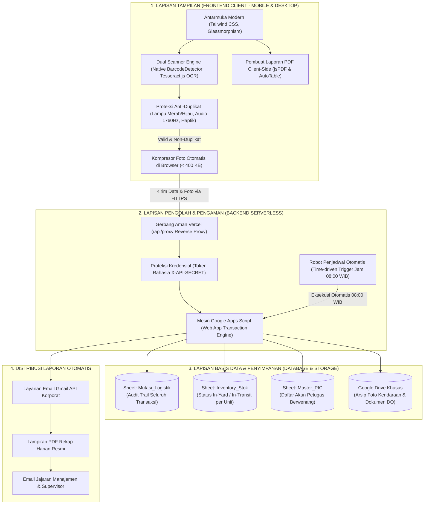
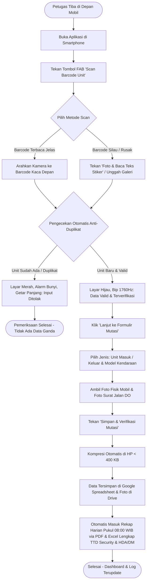

# 🚗 Dokumen Spesifikasi Produk (PRD) & Panduan Sistem Lengkap
## Sistem Management StockYard Kendaraan (Astra Daihatsu DSO Lampung)

> **Klasifikasi:** Dokumen Resmi Spesifikasi Produk, Arsitektur Sistem, Katalog Fitur Menyeluruh & Operasional Bisnis  
> **Sasaran Pembaca:** Manajemen Astra Daihatsu, Kepala Operasional Pool, Supervisor Logistik, Klien Bisnis, Tim Lapangan, & Tim Pengembang  
> **Status Dokumen:** Siap Operasional (*Production-Ready - Versi 2.5 Terverifikasi*)  
> **Lokasi Implementasi:** Pool StockYard Sentra Lampung (Astra Daihatsu DSO Lampung)  

---

## 1. Ringkasan Eksekutif (Executive Summary)

### 1.1 Latar Belakang & Tujuan Transformasi
Operasional pengelolaan dan penataan unit kendaraan di area pool logistik dan StockYard Astra Daihatsu DSO Lampung membutuhkan kecepatan pemrosesan, akurasi data mutlak, dan pencatatan fisik yang dapat dipertanggungjawabkan (*audit-ready*). 

Sistem **Management StockYard (Astra Daihatsu DSO Lampung)** dirancang untuk mengubah proses operasional manual berbasis kertas dan spreadsheet mandiri yang rentan kesalahan menjadi **ekosistem aplikasi web terpadu (Mobile & Desktop PWA)** yang terhubung secara aman dengan teknologi komputasi awan (*cloud*) Google Workspace dan serverless proxy.

### 1.2 Nilai Manfaat Utama bagi Manajemen & Klien
* **Nol Risiko Data Ganda (*Zero Duplicate Entry*)**: Sistem memblokir pemindaian berulang untuk unit yang sama melalui validasi multi-sensor seketika di lapangan.
* **Kecepatan Masuk/Keluar Unit (< 20 Detik per Mobil)**: Petugas lapangan memindai stiker kaca mobil secara otomatis tanpa mengetik manual 17 digit nomor rangka yang rawan salah.
* **Bukti Fisik Wajib & Terarsip Otomatis**: Setiap pergerakan mobil wajib menyertakan foto fisik unit dan foto surat jalan (DO) yang langsung tersimpan rapi di Google Drive perusahaan.
* **Otomasi Laporan Harian Tepat Pukul 08:00 WIB**: Rekap mutasi 24 jam terakhir dalam format PDF resmi Astra Daihatsu dikompilasi dan dikirim otomatis ke email manajemen setiap pagi tanpa perlu kerja lembur admin.
* **Kemudahan Akses Universal**: Dapat diakses langsung melalui browser di smartphone Android, iPhone, tablet, maupun komputer laptop kantor tanpa memerlukan instalasi aplikasi yang membebani memori perangkat.

---

## 2. Perbandingan: Cara Kerja Konvensional vs. Sistem Baru

| Aspek Operasional | Cara Konvensional (Sebelumnya) | Menggunakan Sistem Management StockYard |
| :--- | :--- | :--- |
| **Pencatatan Nomor Rangka (VIN)** | Dicatat manual di kertas surat jalan atau diketik di Excel. Sering terjadi salah baca angka `0` dan huruf `O`, atau `1` dan `I`. | **Pemindaian Otomatis via Kamera Smartphone**. Sistem mengekstrak nomor rangka 17 digit dan nomor mesin dengan normalisasi standar ISO otomotif. |
| **Menghadapi Stiker Kaca Bertumpuk** | Petugas bingung karena stiker kaca Daihatsu memiliki 5-7 baris barcode bertumpuk (nomor DO, PO, suku cadang, VIN, mesin). | **Filter Cerdas Otomatis**. Kamera pintar langsung menyaring dan memilih nomor rangka berawalan `MHK` serta mengabaikan kode pabrik yang tidak relevan. |
| **Pencegahan Unit Terinput Dua Kali** | Baru ketahuan saat ada selisih stok fisik bulanan (*stock opname*). | **Pencegahan Real-Time di Lapangan**. Jika unit sudah tercatat, aplikasi langsung berbunyi peringatan, bergetar panjang, dan layar mengunci tombol simpan. |
| **Arsip Bukti Foto Fisik & Surat Jalan** | Foto tersimpan di galeri WhatsApp petugas lapangan, sering terhapus, buram, atau tercecer. | **Terunggah Otomatis ke Google Drive Resmi**. Foto langsung terhubung dengan nomor rangka kendaraan dan dapat dibuka kapan saja melalui link di laporan. |
| **Laporan Harian ke Pihak Manajemen** | Admin pool harus mengetik rekap manual setiap sore atau pagi hari, rentan terlambat. | **Otomatis Kirim PDF ke Email Jam 08:00 WIB**. Sistem bekerja mandiri merekap mutasi 24 jam terakhir dan melampirkannya dalam format PDF siap cetak. |

---

## 3. Rincian Lengkap Seluruh Fitur Website (Tanpa Terkecuali)

Sistem Management StockYard dirancang dengan antarmuka yang sangat kaya fitur, mencakup 5 tampilan utama, 6 modal kerja khusus, dan puluhan fungsi interaktif yang memudahkan tim lapangan hingga direksi:

```
┌──────────────────────────────────────────────────────────────────────────────────┐
│                   PETA FITUR SISTEM MANAGEMENT STOCKYARD                         │
├───────────────────────────────┬──────────────────────────────────────────────────┤
│ 1. NAVIGASI & HEADER GLOBAL   │ • Status Pool, Dot Notifikasi, Profil PIC,       │
│                               │   Pull-to-Refresh Mobile, Navigasi Tab, FAB Scan │
├───────────────────────────────┼──────────────────────────────────────────────────┤
│ 2. DASHBOARD & ANALITIK       │ • Carousel 13 Model Mobil, Filter Tanggal/Bulan, │
│                               │   4 Kartu KPI, Donut Chart Interaktif, Live Feed │
├───────────────────────────────┼──────────────────────────────────────────────────┤
│ 3. MANAJEMEN INVENTARIS STOK  │ • Ringkasan Status, Grid 13 Model, Filter Cepat, │
│                               │   Pencarian Real-Time, Tombol Drill-down         │
├───────────────────────────────┼──────────────────────────────────────────────────┤
│ 4. RINCIAN MODEL (DRILL-DOWN) │ • Banner Spesifikasi Model, Filter Mutasi Model, │
│                               │   Filter Tanggal, Tabel Rincian Unit per Model   │
├───────────────────────────────┼──────────────────────────────────────────────────┤
│ 5. RIWAYAT MUTASI & EKSPOR    │ • Log Mutasi Komprehensif, Filter Kalender,      │
│                               │   Unduh PDF Berkop Resmi, Cetak, Ekspor Excel    │
├───────────────────────────────┼──────────────────────────────────────────────────┤
│ 6. SCANNER 2-TAHAP & FORM     │ • Dual Engine (Barcode + OCR), Senter, Reticle,  │
│                               │   Alarm Anti-Duplikat, Form Foto Unit & DO       │
├───────────────────────────────┼──────────────────────────────────────────────────┤
│ 7. PUSAT NOTIFIKASI REAL-TIME │ • Indikator Live Sync, Ping Server, Kirim Email  │
│                               │   Manual On-Demand, Filter Riwayat Pengiriman    │
├───────────────────────────────┼──────────────────────────────────────────────────┤
│ 8. PENGATURAN OTOMASI LAPORAN │ • Jam Analog "Jam Bulet", Frekuensi Kirim,       │
│                               │   Multi-Email Chips Manager (> 5 Email Tujuan)   │
├───────────────────────────────┼──────────────────────────────────────────────────┤
│ 9. PENGATURAN & PREFERENSI    │ • Edit Profil PIC, Preferensi Kamera & Senter,   │
│                               │   Toggle Audio/Getar, Bersihkan Cache, Logout    │
├───────────────────────────────┼──────────────────────────────────────────────────┤
│ 10. LIGHTBOX & TOAST ALERT    │ • Penampil Foto Resolusi Penuh, Zoom & Unduh,    │
│                               │   Floating Toast Notifications (Sukses/Peringatan│
└───────────────────────────────┴──────────────────────────────────────────────────┘
```

---

### 3.1 Navigasi Global, Header, & Gestur Mobile
1. **Lencana Status Pool Aktif (*Yard Badge*)**:
   - Menampilkan penanda lokasi resmi pool yang sedang aktif: `Sentra Lampung Pool (Astra Daihatsu DSO)`.
2. **Indikator Lonceng Notifikasi & Pulse Dot**:
   - Ikon lonceng di bagian atas dengan titik merah berdenyut (*pulse dot*) yang menyala otomatis jika terdapat mutasi baru atau update status laporan. Mengeklik ikon ini akan membuka **Modal Notifikasi & Sinkronisasi Real-Time**.
3. **Profil Operator / PIC Header**:
   - Menampilkan foto avatar petugas yang sedang bertugas, nama lengkap PIC (contoh: *Andi Pratama* / *Syafira Fira*), dan peran jabatan (*Staff Operasional* / *Supervisor*).
4. **Navigasi Tab Utama (Desktop & Mobile)**:
   - **Desktop Navigation Bar**: Tab navigasi di bagian atas untuk berpindah seketika antara menu **Dashboard**, **Inventaris**, **Riwayat**, dan **Pengaturan**.
   - **Mobile Floating Bottom Navigation**: Bilah navigasi melayang khusus layar smartphone yang ergonomis dijangkau satu tangan.
5. **Tombol Aksi Cepat Scan (Floating Action Button / FAB)**:
   - Tombol bulat berukuran besar di bagian tengah navigasi bawah dengan animasi berpendar (*glowing pulse*). Menekan tombol ini seketika membuka kamera pemindai unit dari menu manapun.
6. **Gestur Tarik Layar ke Bawah (*Pull-to-Refresh*)**:
   - Khusus pengguna smartphone: petugas cukup menarik layar dari atas ke bawah untuk menyegarkan dan mengambil data stok terbaru dari server. Dilengkapi indikator panah dinamis, teks panduan, dan animasi spinner putar.

---

### 3.2 Tampilan 1: Dashboard & Analitik Real-Time (`viewDashboard`)
1. **Banner Carousel Geser Otomatis (*Hero Carousel 13 Model*)**:
   - Menampilkan visual resmi 13 model kendaraan Daihatsu dalam format tayangan geser (*auto-sliding banner*).
   - Setiap slide memuat nama model, statistik stok unit yang tersedia di pool (*In-Yard*), dan unit dalam perjalanan (*In-Transit*).
   - Dilengkapi tombol navigasi manual (Panah Kiri / Kanan) dan tombol aksi cepat **"Buka Scanner untuk Model Ini"**.
2. **Filter Periode & Rentang Tanggal Dashboard**:
   - Tiga dropdown terintegrasi: Pemilih Tanggal (1–31), Pemilih Bulan (Januari–Desember), dan Pemilih Tahun.
   - Tombol Pintas **"Hari Ini"**: Langsung menyaring data untuk melihat aktivitas pada hari berjalan.
   - Tombol **"Reset / Tampilkan Semua"**: Mengembalikan tampilan untuk melihat ringkasan seluruh data tanpa batasan waktu.
3. **Empat Kartu Ringkasan Kinerja Utama (KPI Cards)**:
   - **Total Unit**: Akumulasi seluruh kendaraan yang terdata di sistem.
   - **Unit In-Yard (Tersedia)**: Jumlah mobil yang berada di dalam area parkir pool Sentra Lampung.
   - **Unit In-Transit (Keluar)**: Jumlah mobil yang sedang dalam proses pengiriman ke dealer/cabang.
   - **Mutasi Periode Terpilih**: Perbandingan langsung jumlah *Unit Masuk* vs *Unit Keluar* pada rentang tanggal yang dipilih.
4. **Diagram Donat Distribusi Model Kendaraan (Interactive Donut Chart)**:
   - Menampilkan diagram lingkaran komposisi persentase jumlah unit per model mobil secara visual.
   - **Interaksi Sentuh/Klik Segmen**: Memilih irisan diagram akan memunculkan kapsul informasi mengambang (*hover capsule*) yang memuat nama mobil, persentase stok, dan jumlah unit fisik.
   - **Kartu Preview Model Terpilih**: Panel samping yang otomatis memperbarui foto model dan detail unit sesuai irisan donat yang sedang diklik.
5. **Umpan Aktivitas Terkini (Live Recent Activity Feed)**:
   - Menampilkan log 5 transaksi mutasi paling mutakhir secara *real-time*.
   - Memuat foto avatar petugas, label status berwarna (*Hijau untuk Unit Masuk*, *Biru untuk Unit Keluar*), nomor rangka VIN, nama model kendaraan, dan stempel waktu transaksi.
   - Dilengkapi tombol cepat untuk membuka riwayat lengkap.

---

### 3.3 Tampilan 2: Manajemen Inventaris Stok (`viewInventory`)
1. **Header Statistik Kategori Stok**:
   - Menampilkan total armada aktif yang dibagi menurut peruntukan (Keluarga/LCGC, SUV/Crossover, Niaga Komersial).
2. **Grid Kartu 13 Model Kendaraan Daihatsu**:
   - Menampilkan kartu visual beresolusi tinggi untuk masing-masing dari 13 model mobil.
   - Setiap kartu menampilkan: nama model resmi, lencana ketersediaan stok, jumlah unit *In-Yard*, jumlah unit *In-Transit*, dan kapasitas maksimum yard.
3. **Filter Tab Status Ketersediaan**:
   - Tiga tombol tab cepat: **Semua Unit**, **Hanya In-Yard (Ada di Pool)**, dan **Hanya In-Transit (Sedang Dikirim)**.
4. **Pencarian Cepat Inventaris Real-Time**:
   - Kolom pencarian teks responsif yang langsung menyaring kartu unit berdasarkan nomor rangka, nomor mesin, atau nama model saat petugas mengetik.
   - Dilengkapi tombol bersihkan pencarian (*clear button*) satu klik.
5. **Tombol Akses Rincian (*Drill-Down Button*)**:
   - Setiap kartu model memiliki tombol **"Lihat Rincian Unit"** yang langsung membuka halaman khusus untuk model tersebut.

---

### 3.4 Tampilan 3: Rincian Model Kendaraan Drill-Down (`viewModelDetail`)
1. **Hero Banner Spesifikasi Model**:
   - Menampilkan visual besar kendaraan terpilih, kategori segmen (misal: *Niaga Komersial Ringan*), kapasitas mesin, dan deskripsi singkat peruntukan unit.
2. **Kartu Ringkasan Model Spesifik**:
   - Jumlah total stok fisik mobil tipe tersebut di Sentra Lampung, perbandingan unit masuk dan keluar khusus tipe tersebut.
3. **Filter Jenis Mutasi Khusus Model**:
   - Tab pemfilteran: Semua Unit, Unit Masuk Saja, Unit Keluar Saja.
4. **Filter Rentang Tanggal Model**:
   - Memungkinkan supervisor memfilter pergerakan model tersebut pada kurun waktu tertentu.
5. **Tabel Rincian Unit Terdaftar**:
   - Menampilkan seluruh nomor sasis (VIN), nomor mesin, tanggal kedatangan/pengiriman, nama petugas penanggung jawab, serta status lokasi unit.
   - Dilengkapi tombol aksi untuk melihat foto unit langsung.
6. **Tombol Navigasi Kembali**:
   - Tombol kembali untuk kembali ke halaman katalog inventaris dengan posisi gulir yang terjaga.

---

### 3.5 Tampilan 4: Riwayat Mutasi & Ekspor Laporan (`viewHistory`)
1. **Tabel Log Mutasi Terintegrasi**:
   - Menampilkan seluruh catatan mutasi keluar-masuk kendaraan secara berurutan (*chronological audit trail*).
   - Kolom tabel mencakup: Waktu Mutasi, Nomor Transaksi, Nomor Rangka (VIN), Nomor Mesin, Model Mobil, Tipe Mutasi, Nama Petugas PIC, Nomor Surat Jalan (DO), Bukti Foto Fisik, dan Catatan Kondisi.
2. **Filter Rentang Kalender Fleksibel**:
   - Input tanggal **Dari Tanggal** dan **Sampai Tanggal** yang memungkinkan audit harian, mingguan, atau bulanan. Dilengkapi tombol reset filter.
3. **Filter Tab Jenis Mutasi**:
   - Tombol cepat: **Semua Mutasi**, **Unit Masuk**, dan **Unit Keluar**.
4. **Pencarian Global Riwayat**:
   - Kotak pencarian yang mampu mencari kecocokan nomor DO, nomor rangka, nomor mesin, model, maupun nama petugas penginput.
5. **Tiga Metode Ekspor Laporan Resmi**:
   - **Cetak Langsung (*Print-Ready*)**: Memformat tabel mutasi ke tata letak cetak ramah kertas A4/Folio tanpa elemen antarmuka website.
   - **Download PDF Berkop Resmi Astra Daihatsu**: Dihasilkan secara instan di dalam browser (*client-side PDF generator via jsPDF/AutoTable*). Menghasilkan dokumen resmi berlogo Astra Daihatsu, nomor dokumen, tanggal cetak, tabel terstruktur, baris jumlah, dan kolom tanda tangan pengesahan Petugas Security, PIC, serta HDA/DM.
   - **Ekspor Format Spreadsheet (Excel / CSV)**: Mengunduh data tabel mentah untuk keperluan analisis keuangan, pembukuan, atau audit internal kantor.
   - **Otomatisasi Email Rekapitulasi Terjadwal (08:00 WIB)**: Mengirimkan email ringkasan eksekutif dengan lampiran dokumen resmi **PDF** dan **Excel (.xlsx)** yang dilengkapi baris jumlah unit serta legalitas tanda tangan **Security Pool** dan **HDA / DM (Head Dept Area / District Manager)**.
6. **Aksi Pembuka Foto Bukti Fisik**:
   - Tombol thumbnail foto mobil dan foto dokumen DO pada setiap baris tabel. Mengeklik tombol ini akan membuka foto dalam ukuran penuh di modal penampil gambar.

---

### 3.6 Tampilan 5: Pengaturan Sistem & Profil Operator (`viewSettings`)
1. **Manajemen Profil Operator / PIC**:
   - Menampilkan foto profil petugas, nama lengkap, NIK/ID petugas, peran akses, dan tanggal mulai bertugas.
   - Tombol **"Edit Profil"** untuk mengubah nama atau memperbarui foto profil petugas.
2. **Pengaturan Konfigurasi Server & Koneksi Cloud**:
   - Pemilih mode koneksi: **Mode Aman Serverless (Vercel Reverse Proxy)** atau **Mode Langsung (Direct Google Apps Script)**.
   - Kolom penyesuaian URL Google Apps Script untuk kemudahan pengujian.
   - Tombol **"Uji Koneksi Server (Ping Cloud)"** untuk memastikan komunikasi ke database Google berjalan normal.
3. **Pengaturan Pemindai Kamera & Perangkat Keras**:
   - **Kamera Utama**: Pilihan kamera belakang (*environment/wide*) atau kamera depan.
   - **Auto-Torch / Senter Otomatis**: Menyalakan lampu kilat smartphone secara otomatis saat memindai di area parkir yang gelap atau malam hari (pada ponsel yang mendukung).
4. **Preferensi Suara & Getaran (Haptik)**:
   - Toggle aktif/nonaktif suara bip audio validasi.
   - Toggle aktif/nonaktif getaran haptik smartphone.
5. **Manajemen Penyimpanan & Memori Lokal**:
   - Tombol **"Sinkronisasi Paksa (*Force Sync*)"**: Menarik ulang seluruh data mutasi dari cloud sheet ke memori smartphone.
   - Tombol **"Bersihkan Cache Lokal (*Clear Storage*)"**: Mengosongkan data sementara jika terjadi kendala pada browser.
6. **Tombol Keluar Sesi (*Logout*)**:
   - Membuka dialog konfirmasi aman sebelum petugas mengakhiri sesi kerja.

---

### 3.7 Modal Kerja 1: Pemindai Kamera 2-Tahap (`#scannerModalOverlay`)
Merupakan fitur inti operasional petugas di lapangan:
* **Tahap 1: Viewport Kamera & Deteksi Cerdas**:
  - Viewport kamera langsung layar penuh dengan bingkai laser merah/hijau 4 sudut.
  - **Tombol Sakelar 2-Mode**:
    - *Mode 1: [║▌║ Barcode Auto]*: Membaca barcode secara otomatis menggunakan akselerasi perangkat keras ponsel.
    - *Mode 2: [🔤 Baca Teks Stiker (OCR)]*: Tombol snapshot darurat jika barcode silau matahari atau rusak; sistem langsung membaca teks nomor rangka di bawah barcode.
  - **Tombol Unggah Foto Stiker dari Galeri**: Petugas dapat memotret stiker dengan aplikasi kamera bawaan ponsel terlebih dahulu, lalu mengunggah fotonya untuk dibaca otomatis oleh OCR Tesseract.
  - **Penyaring Cerdas Multi-Barcode (`smartFilterBarcodes`)**: Otomatis mengenali pola 17 digit VIN `MHK...`, nomor mesin, nomor DO, dan membuang kode pabrik `11...` dan `632...` yang tidak diperlukan.
  - **Pill Ringkasan Ekstraksi**: Menampilkan chip data yang berhasil dikenali (Nomor Rangka, Mesin, DO, Model).
  - **Kolom Input Manual**: Opsi darurat untuk mengetik nomor sasis dan mesin jika stiker kendaraan rusak parah atau tidak ada.
  - **Sistem Alarm Anti-Duplikasi Multi-Sensory**:
    - *Jika Duplikat*: Alarm audio nada rendah (440Hz -> 330Hz), getaran panjang di ponsel, bingkai kamera menyala **MERAH**, dan navigasi ke formulir diblokir.
    - *Jika Baru / Valid*: Bunyi bip nada tinggi (1760Hz), getaran pendek, bingkai terkunci **HIJAU**, chip berubah status menjadi **"TERVERIFIKASI"**, dan tombol lanjut ke tahap 2 aktif.
* **Tahap 2: Formulir Serah Terima Mutasi Unit**:
  - Banner identitas nomor sasis dan mesin yang telah terkunci (mencegah salah input).
  - Pilihan radio button: **Unit Masuk** atau **Unit Keluar**.
  - Dropdown pilihan **13 Model Resmi Kendaraan Daihatsu**.
  - **Dropdown Cabang / Kode Berita Acara (No. BA)**: Menu dropdown terstandar untuk memilih cabang & kode BA resmi:
    - **D660 - Ahmad Yani** (Default)
    - **D661 - Soekarno Hatta**
    - **D662 - Bandar Jaya**
    - **D663 - Lampung Utara**
    - **D664 - Lampung Timur**
  - **Dua Slot Unggahan Foto Wajib**:
    - *Slot 1: Foto Fisik Mobil* (langsung memicu kamera smartphone).
    - *Slot 2: Foto Dokumen Surat Jalan DO* (langsung memicu kamera smartphone).
    - Dilengkapi preview thumbnail foto dan tombol ganti foto.
  - Kolom teks catatan kondisi fisik kendaraan.
  - Tombol **"Simpan & Verifikasi Mutasi"** yang dilengkapi indikator putar saat proses kompresi dan pengiriman data berlangsung.

---

### 3.8 Modal Kerja 2: Penampil Foto Resolusi Penuh (`#imagePreviewModal`)
* Komponen *lightbox popup* yang menampilkan foto fisik mobil atau dokumen surat jalan dalam resolusi tajam.
* Dilengkapi judul foto, nomor rangka kendaraan terkait, tombol perbesar/perkecil (*zoom*), tombol unduh berkas ke memori HP, dan tombol tutup.

---

### 3.9 Modal Kerja 3: Pusat Notifikasi & Sinkronisasi Database (`#emailNotificationModal`)
Dapat diakses kapan saja dari ikon lonceng pada bilah atas:
1. **Indikator Live Sync Database**: Titik lampu hijau berkedip (*pulsing dot*) yang mengindikasikan koneksi data antara web app dan Google Sheets berjalan mulus.
2. **Pengecekan Mode Koneksi**: Menampilkan label mode yang sedang aktif (*PROXY SECURE* vs *DIRECT APPS SCRIPT*).
3. **Tombol Uji Koneksi Cepat (*Ping Server*)**: Menguji respon server backend secara instan dalam 1 detik.
4. **Pengaturan Direct Connection Box**: Panel lipat untuk memasukkan URL Apps Script kustom bagi keperluan teknis.
5. **Daftar Target Email Penerima**: Menampilkan alamat email manajemen yang akan menerima laporan.
6. **Tombol Kirim Laporan Manual (*On-Demand Dispatch*)**:
   - Memungkinkan supervisor memicu pengiriman rekapitulasi laporan PDF ke email saat itu juga tanpa perlu menunggu jadwal otomatis jam 08:00 WIB.
7. **Filter Riwayat Notifikasi Email**:
   - Empat tab filter: **Semua**, **Unit Masuk**, **Unit Keluar**, dan **Laporan Harian**.
8. **Daftar Log Riwayat Email Real-Time**:
   - Menampilkan catatan riwayat setiap email yang berhasil dikirimkan ke manajemen beserta stempel waktu dan status pengiriman.

---

### 3.10 Modal Kerja 4: Pengaturan Jadwal Laporan Otomatis (`#editScheduleModal`)
* **Antarmuka Jam Analog Interaktif ("Jam Bulet" Clock Face)**:
  - Antarmuka visual jam dinding analog interaktif yang memudahkan supervisor memilih jam dan menit pengiriman cukup dengan menyentuh/mengeklik jarum jam.
  - Format 24 jam dengan waktu default standar korporat: **08:00 WIB**.
* **Pilihan Frekuensi Pengiriman**:
  - Tiga opsi frekuensi: **Harian (Setiap Hari)**, **Hari Kerja Saja (Senin–Jumat)**, atau **Mingguan (Setiap Hari Senin)**.
* **Tombol Simpan Jadwal**: Menyimpan konfigurasi jadwal ke server backend.

---

### 3.11 Modal Kerja 5: Manajemen Multi-Email Penerima Laporan (`#editTargetEmailModal`)
* **Sistem Multi-Email Chips**:
  - Memungkinkan penambahan lebih dari 5 alamat email penerima sekaligus (misalnya: Kepala Cabang, Supervisor Pool, Admin Logistik, dan Divisi Audit).
  - Setiap email ditampilkan dalam bentuk kapsul (*chips*) interaktif berikon surat.
  - Dilengkapi tombol silang (✕) pada setiap kapsul untuk menghapus email dengan cepat.
* **Validasi Format Email Otomatis**: Memastikan alamat email yang diketik memiliki format yang valid sebelum ditambahkan.

---

### 3.12 Modal Kerja 6: Dialog Konfirmasi Keluar Akun (`#logoutModal`)
* Dialog konfirmasi pop-up yang elegan dan aman saat tombol keluar ditekan.
* Menyajikan dua opsi tegas: **"Batal"** (kembali ke aplikasi) atau **"Ya, Keluar"** (mengakhiri sesi kerja petugas dan membersihkan status sesi).

---

### 3.13 Komponen Pesan Melayang (*Floating Toast Notifications*)
* Komponen notifikasi pop-up yang muncul di sudut atas layar untuk memberi tahu hasil setiap tindakan pengguna secara non-intrusif:
  - **Toast Sukses (Hijau Emerald)**: Saat data mutasi berhasil disimpan, foto terunggah, atau email laporan berhasil dikirim.
  - **Toast Peringatan / Duplikat (Merah Ruby)**: Saat nomor sasis sudah pernah ada di database, formulir belum lengkap, atau jaringan bermasalah.
  - **Toast Informasi (Biru Safir)**: Saat filter diterapkan, pencarian diperbarui, atau sinkronisasi data sedang berjalan.
  - **Toast Loading (Animasi Spinner)**: Saat sistem sedang mengompresi gambar atau menunggu respon dari Google Cloud.

---

## 4. Arsitektur Tiga Lapis (Frontend, Backend, & Database)



---

## 5. Spesifikasi Lengkap Basis Data (Google Sheets & Drive)

Seluruh data transaksi dan inventaris disimpan dalam format tabel Google Spreadsheet yang sangat transparan dan dapat dibuka langsung layaknya dokumen Microsoft Excel oleh pihak manajemen:

### 5.1 Lembar Kerja 1: `Mutasi_Logistik` (Buku Besar Rekam Jejak)
| Kolom | Nama Kolom Spreadsheet | Tipe Data | Contoh Isi Data | Penjelasan Fungsi Data |
| :---: | :--- | :--- | :--- | :--- |
| **A** | `timestamp` | Tanggal & Jam | `2026-10-21 08:30:15` | Waktu persis saat mutasi dicatat di pool |
| **B** | `mutation_id` | Teks Unik | `MUT-20261021-0012` | Nomor urut kode transaksi mutasi |
| **C** | `vin_number` | Teks (17 Karakter) | `MHKP3FA1JTK137533` | Nomor Rangka resmi kendaraan (Kunci Utama) |
| **D** | `engine_number` | Teks | `2NR4F82393` | Nomor Mesin kendaraan |
| **E** | `car_model` | Teks Pilihan | `Gran Max Pick Up` | Varian model dari 13 katalog resmi Daihatsu |
| **F** | `mutation_type` | Teks Pilihan | `Unit Masuk` / `Unit Keluar` | Jenis pergerakan kendaraan di area pool |
| **G** | `pic_name` | Teks | `Syafira Fira` | Nama petugas resmi yang melakukan serah terima |
| **H** | `no_ba` / `cabang` | Teks (Dropdown) | `D660 - Ahmad Yani` | Kode BA & Cabang (D660 - Ahmad Yani, D661 - Soekarno Hatta, D662 - Bandar Jaya, D663 - Lampung Utara, D664 - Lampung Timur) |
| **I** | `do_number` | Teks Angka | `2260411667` | Nomor Surat Jalan / Delivery Order resmi |
| **J** | `unit_photo_url` | Tautan URL | `https://drive.google.com/uc?id=...` | Tautan langsung untuk membuka foto fisik mobil |
| **K** | `doc_photo_url` | Tautan URL | `https://drive.google.com/uc?id=...` | Tautan langsung untuk membuka foto surat jalan DO |
| **L** | `keterangan` | Teks Catatan | `Kondisi mulus, spion lengkap, baret halus bemper` | Catatan kondisi fisik kendaraan saat serah terima |

### 5.2 Lembar Kerja 2: `Inventory_Stok` (Status Posisi Terkini Unit)
| Kolom | Nama Kolom Spreadsheet | Tipe Data | Contoh Isi Data | Penjelasan Fungsi Data |
| :---: | :--- | :--- | :--- | :--- |
| **A** | `vin_number` | Teks (17 Karakter) | `MHKP3FA1JTK137533` | Nomor Rangka kendaraan |
| **B** | `engine_number` | Teks | `2NR4F82393` | Nomor Mesin kendaraan |
| **C** | `no_ba` / `cabang` | Teks (Dropdown) | `D660 - Ahmad Yani` | Kode BA & Cabang Resmi Astra Daihatsu Lampung |
| **D** | `car_model` | Teks | `Gran Max Pick Up` | Model kendaraan |
| **E** | `current_status` | Status | `IN_YARD` / `IN_TRANSIT` | **IN_YARD** (Ada di pool) atau **IN_TRANSIT** (Keluar/Jalan) |
| **F** | `last_mutation_type` | Teks | `Unit Masuk` | Jenis mutasi terakhir yang dialami unit |
| **G** | `last_updated` | Tanggal & Jam | `2026-10-21 08:30:15` | Waktu pembaruan status terakhir |
| **H** | `pic_in_charge` | Teks | `Syafira Fira` | Petugas penanggung jawab terakhir |

### 5.3 Lembar Kerja 3: `Master_PIC` (Daftar Identitas Petugas)
| Kolom | Nama Kolom | Tipe Data | Contoh Isi | Penjelasan |
| :---: | :--- | :--- | :--- | :--- |
| **A** | `pic_id` | Teks | `PIC-001` | Kode identitas petugas |
| **B** | `username` | Teks | `syafira` | Nama akun login petugas |
| **C** | `full_name` | Teks | `Syafira Fira` | Nama lengkap resmi petugas lapangan |
| **D** | `email` | Teks | `admin.logistics@daihatsu.co.id` | Email koordinasi resmi |
| **E** | `role` | Pilihan | `YARD_OFFICER` / `SUPERVISOR` | Tingkat hak akses petugas |

### 5.4 Brankas Google Drive (Penyimpanan Foto Bukti Fisik)
* Disimpan di dalam folder terpusat Google Drive resmi perusahaan.
* Standar penamaan file otomatis:
  - Foto Mobil: `UNIT_[NomorRangka]_[Waktu].jpg`
  - Foto Surat Jalan DO: `DO_[NomorRangka]_[Waktu].jpg`
* Foto dapat langsung dibuka melalui tautan pada tabel spreadsheet maupun laporan PDF.

---

## 6. Katalog 13 Model Resmi Kendaraan Daihatsu

Sistem telah diprogram mengenali dan mengelompokkan 13 varian model resmi kendaraan Daihatsu yang beredar di pasar:

| No | Nama Model Kendaraan | Kategori Segmen | Karakteristik Penggunaan Lapangan |
| :-: | :--- | :--- | :--- |
| **1** | **All New Ayla** | Hatchback / LCGC | Penempatan di area parkir city car / compact yard |
| **2** | **New Sigra** | MPV 7-Seater / LCGC | Unit volume tinggi, fast-moving distribusi keluarga |
| **3** | **All New Xenia** | MPV Keluarga | Mobil keluarga multifungsi, perputaran unit tinggi |
| **4** | **New Terios** | Compact SUV | Unit petualang / medium ground clearance |
| **5** | **Terios Special Edition (SE)**| Compact SUV Khusus | Unit edisi terbatas dengan aksesoris khusus |
| **6** | **New Rocky** | Compact Crossover | Unit SUV turbo compact modern |
| **7** | **Rocky ADS** | Crossover Sporty | Edisi sporty dengan paket bodykit Astra Daihatsu Styling |
| **8** | **Rocky Hybrid** | Crossover Elektrik/Hybrid | Penanganan khusus unit berteknologi baterai/hybrid |
| **9** | **New Sirion** | City Car Premium | Hatchback premium perkotaan |
| **10**| **Gran Max Pick Up** | Niaga Komersial Ringan | Armada angkutan barang terbuka, frekuensi mutasi tinggi |
| **11**| **Gran Max Blind Van** | Niaga Kargo Tertutup | Armada tertutup untuk ekspedisi dan kargo logistik |
| **12**| **Gran Max Minibus** | Niaga Penumpang / Travel | Armada angkutan penumpang umum / travel |
| **13**| **Daihatsu Luxio** | Minibus Eksekutif | Kendaraan komersial premium berkapasitas lega |

---

## 7. Alur Kerja Operasional Petugas Lapangan (SOP Ringkas)



---

## 8. Keamanan Sistem, Privasi Data, & Kepatuhan Korporat

1. **Pencegahan Kebocoran Kode & Data (Zero Public Secrets)**:
   - Tidak ada berkas kode Google Apps Script (`.gs`) yang disimpan di dalam repositori publik.
   - Kredensial URL database, folder ID Drive, dan secret token terlindungi di balik Reverse Proxy Vercel (`/api/proxy`).
2. **Koneksi Terenkripsi Penuh (SSL/TLS 256-Bit)**:
   - Seluruh komunikasi dari smartphone petugas ke server cloud menggunakan protokol HTTPS yang aman dari penyadapan data.
3. **Pembagian Hak Akses Berjenjang (Role-Based Access Control)**:
   - Petugas lapangan hanya memiliki hak memasukkan dan memverifikasi unit mutasi.
   - Pihak manajemen, kepala pool, dan supervisor memiliki hak administratif penuh untuk memeriksa spreadsheet, folder Google Drive, serta mengatur jadwal pengiriman laporan.

---

## 9. Indikator Kinerja Utama (Key Performance Indicators)

| Indikator Kinerja (KPI) | Target Standar | Dampak Nyata bagi Bisnis |
| :--- | :---: | :--- |
| **Tingkat Kesalahan Data Ganda (*Duplicate Rate*)** | **0% (Nol Kesalahan)** | Menghilangkan selisih stok antara catatan sistem dan stok fisik mobil di pool. |
| **Kecepatan Input per Mobil** | **< 20 Detik** | Efisiensi tinggi: petugas dapat memproses puluhan mobil yang baru tiba dalam hitungan menit. |
| **Akurasi Pemindaian Nomor Sasis** | **> 98%** | Mencegah kesalahan manusia (*human error*) dalam membaca nomor rangka 17 digit. |
| **Kelengkapan Bukti Foto Fisik** | **100% Wajib** | Setiap transaksi memiliki bukti foto fisik mobil dan foto surat jalan DO yang valid. |
| **Ketepatan Pengiriman Laporan Harian** | **Tepat Jam 08:00 WIB** | Manajemen selalu menerima laporan rekapitulasi setiap pagi secara konsisten. |

---

## 10. Pertanyaan yang Sering Diajukan (FAQ) untuk Tim Lapangan

> [!NOTE]
> **T: Bagaimana jika stiker kaca mobil terkena pantulan sinar matahari yang silau atau sobek?**  
> **J:** Petugas cukup menekan tombol **"🔤 Baca Teks Stiker (OCR)"**. Kamera akan mengambil gambar beresolusi tinggi, meningkatkan kontras secara otomatis, dan membaca deretan teks nomor rangka di bawah barcode. Petugas juga bisa memotret stiker dari aplikasi kamera bawaan lalu mengunggahnya dari galeri ponsel.

> [!TIP]
> **T: Apakah supervisor bisa mengirimkan laporan rekap PDF ke email manajemen sewaktu-waktu tanpa menunggu jam 08:00 WIB?**  
> **J:** Sangat bisa. Cukup klik ikon lonceng notifikasi di bagian atas, lalu tekan tombol **"Kirim Laporan"**. Sistem akan langsung merekap data saat itu juga dan mengirimkannya ke email tujuan dalam hitungan detik.

> [!IMPORTANT]
> **T: Apa yang terjadi jika sinyal internet di area parkir pool tiba-tiba hilang saat memotret unit?**  
> **J:** Aplikasi dilengkapi memori cadangan lokal (*Local Storage*). Jika koneksi gagal, sistem akan menampilkan notifikasi peringatan agar petugas dapat menekan kembali tombol kirim saat sinyal kembali normal tanpa harus memotret atau memindai ulang dari awal.

---

## 11. Pengesahan & Kontak Dukungan Layanan

Dokumen spesifikasi produk dan cetak biru sistem ini merupakan acuan operasional dan teknis resmi bagi seluruh pemangku kepentingan Astra Daihatsu DSO Lampung:

* **Penanggung Jawab Sistem:** Tim Sistem Informasi & Manajemen StockYard Astra Daihatsu DSO Lampung  
* **Email Dukungan Resmi:** `admin.logistics@daihatsu.co.id`  
* **Pusat Operasional:** Pool StockYard Sentra Lampung (Astra Daihatsu DSO Lampung)  
* **Status Dokumen:** Disetujui untuk Operasional Penuh (Versi 2.5 - Terverifikasi)  
