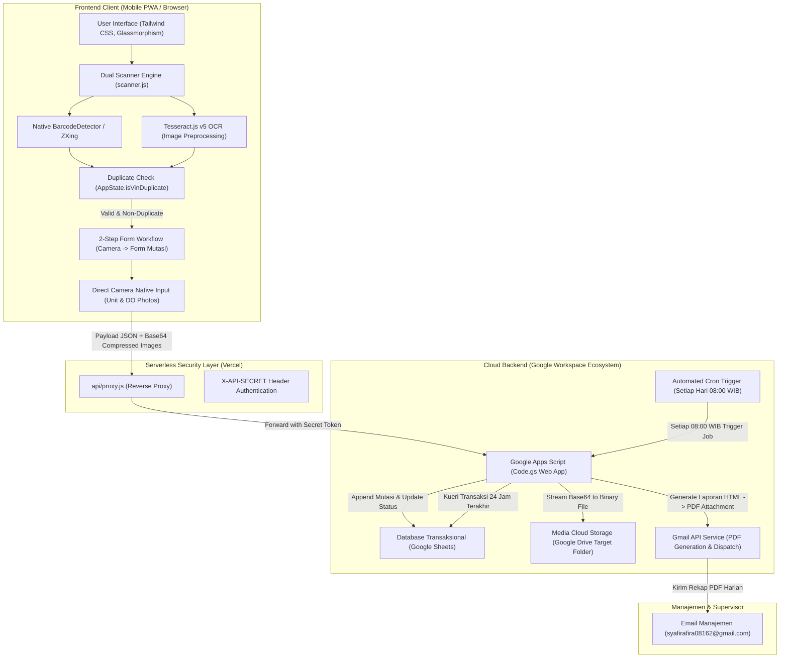
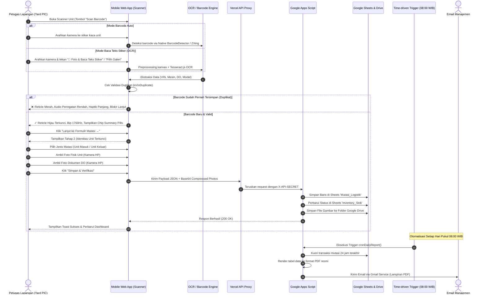

# 🚗 PRD & Arsitektur Teknis: Daihatsu Vehicle Logistics & Salvage Management

> **Dokumen Spesifikasi Produk (PRD) & Cetak Biru Arsitektur Sistem Informasi Logistik**  
> **Klasifikasi:** Dokumen Teknis Resmi Tingkat Korporat (Enterprise IT Document)  
> **Versi Rilis:** 2.4.0 (Production-Ready)  
> **Lingkungan:** Web Mobile-First (PWA Ready), Serverless Vercel, & Google Cloud Workspace  

---

## 1. Executive Summary & Problem Framing

### 1.1 Latar Belakang & Kebutuhan Operasional
Operasional penanganan unit kendaraan di pool logistik dan unit penanganan khusus (*salvage*) Astra Daihatsu memerlukan akurasi, kecepatan, dan auditabilitas fisik yang tinggi. Setiap pergerakan unit—baik penerimaan dari pabrik/vendor (*Unit Masuk*) maupun pengiriman ke dealer/ekspedisi (*Unit Keluar*)—wajib tercatat secara instan tanpa kesalahan nomor sasis (*Vehicle Identification Number* / VIN 17 digit).

### 1.2 Masalah Lapangan (*Field Pain Points*)
1. **Kompleksitas Stiker Kaca (*Multi-Barcode Windshield Label*)**:
   - Pada stiker kaca depan asli Astra Daihatsu (seperti contoh label Karawang), terdapat hingga **7 baris barcode bertumpuk** (Nomor DO/Surat Jalan `22...`, Nomor PO `632...`, Kode Material `11...`, Nomor Rangka VIN `MHK...`, dan Nomor Mesin `2NR...`).
   - Kamera pemindai biasa kerap salah mendeteksi barcode teratas (No. DO) alih-alih nomor VIN, atau terganggu pantulan silau matahari (*glare*) pada kaca mobil melengkung.
2. **Risiko Duplikasi Data (*Double-Entry Disaster*)**:
   - Potensi unit yang sama terpindai berulang kali oleh petugas lapangan, mengakibatkan selisih fisik dengan pencatatan inventaris (*inventory variance*).
3. **Penyimpanan Bukti Fisik yang Tercecer**:
   - Foto unit dan foto dokumen DO fisik rentan tertinggal di ponsel petugas tanpa tautan langsung ke database logistik terpusat.
4. **Beban Rekonsiliasi Harian**:
   - Admin pool harus merekap mutasi harian secara manual setiap pagi untuk dilaporkan ke pihak manajemen cabang.

### 1.3 Solusi Sistem Terintegrasi
Sistem **Daihatsu Vehicle Logistics & Salvage Management** menghadirkan solusi menyeluruh:
- **Dual-Engine Scanning**: Kombinasi *Hardware-accelerated Native BarcodeDetector* dan *OCR Tesseract.js* untuk membaca teks baris kode di bawah garis barcode secara instan.
- **Smart Multi-Barcode Filtering (`smartFilterBarcodes`)**: Algoritma cerdas yang memilah dan memprioritaskan 17-digit VIN berawalan `MHK`, nomor mesin, dan nomor DO.
- **Validasi Ketat Anti-Duplikat (1 Barcode = 1 Catatan)**: Proteksi multi-sensor (audio frekuensi rendah, haptik panjang, reticle merah menyala, dan pemblokiran form).
- **Alur Kerja 2-Tahap (*2-Step Progressive Handover*)**: Tahap 1 fokus pada verifikasi identitas unit; Tahap 2 melengkapi dokumen dan foto langsung dari kamera smartphone.
- **Arsitektur Cloud Serverless (Google Workspace)**: Google Sheets sebagai basis data transaksional, Google Drive sebagai penyimpanan bukti fisik foto, dan Google Apps Script dengan *Time-driven Trigger* setiap pukul **08:00 WIB** untuk mengirimkan rekap PDF mutasi 24 jam terakhir ke email manajemen.

---

## 2. Arsitektur Sistem & Aliran Data (Data Flow Architecture)



---

## 3. Struktur Direktori Proyek & Rincian Kode

```text
Management Salvage/
├── api/
│   └── proxy.js                # Vercel Serverless Function (Reverse Proxy & Kredensial Terenkripsi)
├── assets/
│   ├── css/
│   │   └── styles.css          # Animasi laser scanner, custom scrollbar, glassmorphism, responsive UI
│   ├── images/                 # Banner & visual resmi 13 model Daihatsu (Ayla, Sigra, Xenia, Rocky, dll.)
│   └── js/
│       ├── config.js           # Konfigurasi routing API, secret token, dan endpoint backend
│       ├── state.js            # Single source of truth (State management, inventory calculation, cache)
│       ├── api.js              # HTTP Client Service untuk komunikasi aman ke proxy/Apps Script
│       ├── scanner.js          # Hardware camera, Dual Barcode & OCR Tesseract, Smart Filter, Audio/Haptics
│       ├── ui.js               # UI Renderer (Dashboard, Modal, Riwayat Mutasi, Tabel Stok, Toast, Filter)
│       └── app.js              # Entrypoint utama aplikasi & orchestrator inisialisasi lifecycle
├── index.html                  # Master Single Page Application (SPA) semantic layout
├── vercel.json                 # Routing rules, header keamanan, dan konfigurasi serverless Vercel
├── .gitignore                  # Proteksi keamanan repository (mengecualikan file credential/rahasia)
└── README.md                   # Dokumen PRD & Arsitektur Teknis Sistem (File ini)
```

### 3.1 Penjelasan Rinci Setiap Modul Kode (*Code Breakdown*)

#### 1. [`index.html`](file:///index.html) — Antarmuka Pengguna Utama (SPA)
- **Header & Profil Navigasi**: Status sinkronisasi real-time, lencana yard aktif (*Sentra Lampung Pool*), dan penunjuk waktu.
- **Hero Carousel Banner (13 Model Resmi Daihatsu)**: Visual bergerak (*auto-sliding carousel*) yang memuat statistik pergerakan stok unit In-Yard dan In-Transit untuk Rocky Hybrid, Terios SE, New Terios, All New Xenia, New Sigra, All New Ayla, New Rocky, Rocky ADS, New Sirion, Luxio, Gran Max Minibus, Gran Max Blind Van, dan Gran Max Pick Up.
- **Modal Pemindai 2-Tahap (`#scannerModalOverlay`)**:
  - **Tahap 1 (`#scanStep1_Camera`)**: Viewport kamera live, reticle laser dengan deteksi 4 sudut, pemilih mode ganda (*[║▌║ Barcode Auto]* vs *[🔤 Baca Teks (OCR)]*), tombol snapshot OCR, tombol pemilih galeri, chip indikator feedback, summary pills ekstraksi data (VIN, Mesin, DO), serta kolom input VIN & Mesin.
  - **Tahap 2 (`#scanStep2_Form`)**: Formulir serah terima kendaraan, banner identitas unit terverifikasi, pilihan jenis mutasi (*Unit Masuk* / *Unit Keluar*), dropdown 13 model Daihatsu, dual-upload foto fisik unit dan foto dokumen DO (langsung memanggil sensor kamera ponsel), serta textarea keterangan kondisi.
- **Tabel Inventaris & Riwayat Mutasi**: Dilengkapi tab filter status (*Semua, In-Yard, In-Transit*), bar pencarian dinamis, dan modal pembesar gambar (*image lightbox*).

#### 2. [`assets/js/scanner.js`](file:///assets/js/scanner.js) — Hardware & Optical Recognition Module
- **Dual Decoding Engine**:
  - **Native BarcodeDetector**: Menggunakan akselerasi GPU perangkat keras bawaan Chromium untuk pembacaan instan dalam interval loop 140ms.
  - **ZXing BrowserMultiFormatReader**: Fallback tingkat industri dengan konfigurasi `TRY_HARDER` dan format spesifik otomotif (Code 128, Code 39, QR Code, Data Matrix).
- **OCR Tesseract.js Engine**:
  - `captureAndScanOCR()`: Mengambil snapshot resolusi penuh dari `<video>`, menjalankan `preprocessCanvasForOCR()` untuk konversi grayscale dan peningkatan kontras 35%, lalu mengekstrak teks baris kode menggunakan `Tesseract.recognize()`.
  - `handleStickerPhotoUploaded(event)`: Membaca file foto stiker dari galeri ponsel dan mengekstrak datanya via OCR.
- **Smart Multi-Barcode Filtering (`smartFilterBarcodes`)**:
  - Mengeliminasi kode material SAP (`11...`) dan nomor PO (`632...`).
  - Mengisolasi dan memvalidasi nomor rangka VIN 17 karakter berawalan `MHK` atau `MFK`/`MR`.
  - Mengisolasi nomor mesin Daihatsu (`2NR`, `1KR`, `3NR`, `WA`, `3SZ`, `KF`).
  - Mengisolasi nomor DO 10 digit (`22...`).
- **Normalisasi Karakter Otomotif**:
  - Mencegah kesalahan umum OCR pada karakter angka (`I` -> `1`, `O` -> `0`, `Q` -> `0`, `S` -> `5`, `Z` -> `2`) pada nomor seri digit VIN sesuai standar ISO 3779.
- **Validasi Anti-Duplikasi & Multi-Sensory Feedback**:
  - Memanggil `AppState.isVinDuplicate(vin)`.
  - *Jika Duplikat*: Bunyi alarm nada rendah sawtooth (440Hz -> 330Hz), getaran haptik panjang (*180-80-240ms*), reticle berubah merah menyala, dan navigasi ke form diblokir.
  - *Jika Baru / Valid*: Bunyi bip frekuensi tinggi (1760Hz), getaran haptik standar (*80-40-80ms*), reticle terkunci hijau emerald, dan status pill berubah menjadi `TERVERIFIKASI`.

#### 3. [`assets/js/state.js`](file:///assets/js/state.js) — Single Source of Truth & Local Storage
- Mengelola state global aplikasi: `AppState.inventory`, `AppState.mutations`, `AppState.activeFilter`, `AppState.searchQuery`.
- **Fungsi Kunci Anti-Duplikasi (`isVinDuplicate`)**:
  ```javascript
  isVinDuplicate(vin) {
    if (!vin) return false;
    const cleanVin = String(vin).trim().toUpperCase();
    const inMutations = this.mutations.some(m => String(m.vin || '').trim().toUpperCase() === cleanVin);
    const inInventory = this.inventory.some(i => String(i.vin || '').trim().toUpperCase() === cleanVin);
    return inMutations || inInventory;
  }
  ```
- **Fungsi Sinkronisasi Inventaris**: Otomatis menghitung ulang stok unit In-Yard vs In-Transit untuk setiap model kendaraan ketika terjadi mutasi baru.
- **Offline Persistence**: Menyimpan cadangan data mutasi sementara di `localStorage` jika jaringan internet lapangan mengalami kendala.

#### 4. [`assets/js/api.js`](file:///assets/js/api.js) — Komunikasi Jaringan & Gateway API
- Bertindak sebagai service layer untuk mengirimkan request ke backend:
  - `fetchInventory()`: Mengambil data inventaris dan riwayat mutasi dari database.
  - `submitMutation(mutationData)`: Mengirimkan payload transaksi mutasi beserta payload foto terkompresi Base64.
  - `checkVinAvailability(vin)`: Verifikasi duplikasi VIN secara remote ke server.
- Otomatis mengarahkan ke Vercel Serverless Reverse Proxy (`/api/proxy`) pada lingkungan produksi atau fallback langsung jika menggunakan mode standalone.

#### 5. [`assets/js/ui.js`](file:///assets/js/ui.js) — Renderer Tampilan & Event Handlers
- **Render Dashboard**: Memperbarui kartu statistik (*Total Unit, In-Yard, In-Transit, Mutasi Hari Ini*).
- **Render Tabel Riwayat Mutasi**: Menghasilkan baris tabel yang rapi, lencana status (*Badge Hijau/Biru*), tombol preview foto unit dan foto dokumen DO.
- **Render Tabel Stok per Model**: Menampilkan detail stok per masing-masing dari 13 model Daihatsu.
- **Kompresi Gambar di Sisi Klien**: Mengompresi file foto kamera smartphone berukuran besar menjadi JPEG teroptimasi (< 400 KB) sebelum diunggah ke cloud.
- **Toast Notification Engine**: Komponen notifikasi pop-up mengambang untuk memberikan umpan balik instan ke pengguna.

#### 6. [`assets/js/config.js`](file:///assets/js/config.js) — Manajemen Konfigurasi
- Menyimpan konfigurasi lingkungan, URL endpoint backend, durasi timeout, dan konstanta nama sheet.

#### 7. [`assets/js/app.js`](file:///assets/js/app.js) — App Orchestrator & Lifecycle
- Menginisialisasi event listeners, mendaftarkan keyboard shortcuts, memuat data awal dari backend, dan menyelaraskan siklus hidup aplikasi (*DOM ready & service startup*).

#### 8. [`assets/css/styles.css`](file:///assets/css/styles.css) — Desain & Animasi Khusus
- Styling efek laser scanner vertikal (`@keyframes scanLaser`), animasi reticle pulsing, scrollbar tersembunyi, dan utilitas responsif.

#### 9. [`api/proxy.js`](file:///api/proxy.js) & [`vercel.json`](file:///vercel.json) — Serverless Gateway
- Berjalan di edge serverless function Vercel.
- Menyembunyikan URL asli Google Apps Script dan secret token dari inspeksi jaringan browser (*DevTools*).
- Mengamankan komunikasi dengan menyisipkan header rahasia `X-API-SECRET` sebelum request diteruskan ke backend Google Apps Script.

---

## 4. Alur Kerja Operasional Lapangan (Step-by-Step SOP)



---

## 5. Spesifikasi Basis Data & Google Workspace Backend

### 5.1 Skema Lembar Kerja (*Google Sheets Database Schema*)

#### Sheet 1: `Mutasi_Logistik` (Buku Besar Mutasi Unit)
| Indeks | Nama Kolom | Format Data | Contoh Isi | Keterangan |
| :---: | :--- | :--- | :--- | :--- |
| **A** | `timestamp` | DATETIME | `2026-10-14 08:30:15` | Waktu pencatatan mutasi di lapangan |
| **B** | `mutation_id` | STRING | `MUT-20261014-0041` | Kode unik transaksi mutasi |
| **C** | `vin_number` | STRING (17) | `MHKP3FA1JTK137533` | Nomor Rangka Unit (Index Unik) |
| **D** | `engine_number` | STRING | `2NR4F82393` | Nomor Mesin Kendaraan |
| **E** | `car_model` | STRING | `Gran Max Pick Up` | Model resmi dari 13 katalog Daihatsu |
| **F** | `mutation_type` | ENUM | `Unit Masuk` / `Unit Keluar` | Jenis pergerakan logistik |
| **G** | `pic_name` | STRING | `Syafira Fira` | Nama petugas PIC yang bertugas |
| **H** | `do_number` | STRING | `2260411667` | Nomor Delivery Note / Surat Jalan |
| **I** | `unit_photo_url` | URL STRING | `https://drive.google.com/uc?id=...` | Tautan langsung foto fisik unit di Drive |
| **J** | `doc_photo_url` | URL STRING | `https://drive.google.com/uc?id=...` | Tautan langsung foto dokumen DO di Drive |
| **K** | `keterangan` | TEXT | `Unit tiba kondisi baik, perlengkapan lengkap` | Catatan kondisi fisik unit |

#### Sheet 2: `Inventory_Stok` (Status Terkini Inventaris Yard)
| Indeks | Nama Kolom | Format Data | Contoh Isi | Keterangan |
| :---: | :--- | :--- | :--- | :--- |
| **A** | `vin_number` | STRING (17) | `MHKP3FA1JTK137533` | Primary Key unik per unit kendaraan |
| **B** | `engine_number` | STRING | `2NR4F82393` | Nomor Mesin |
| **C** | `car_model` | STRING | `Gran Max Pick Up` | Model Kendaraan |
| **D** | `current_status` | ENUM | `IN_YARD` / `IN_TRANSIT` | Status lokasi fisik unit saat ini |
| **E** | `last_mutation_type` | STRING | `Unit Masuk` | Jenis mutasi terakhir |
| **F** | `last_updated` | DATETIME | `2026-10-14 08:30:15` | Timestamp pembaharuan status |
| **G** | `pic_in_charge` | STRING | `Syafira Fira` | PIC penanggung jawab terakhir |

#### Sheet 3: `Master_PIC` (Autentikasi & Daftar Petugas)
| Indeks | Nama Kolom | Format Data | Contoh Isi | Keterangan |
| :---: | :--- | :--- | :--- | :--- |
| **A** | `pic_id` | STRING | `PIC-001` | ID identifikasi petugas |
| **B** | `username` | STRING | `syafira` | Username login |
| **C** | `password_hash` | STRING | `***` | Password terenkripsi / PIN petugas |
| **D** | `full_name` | STRING | `Syafira Fira` | Nama lengkap resmi PIC |
| **E** | `email` | STRING | `syafirafira08162@gmail.com` | Email koordinasi petugas |
| **F** | `role` | ENUM | `YARD_OFFICER` / `SUPERVISOR` | Hak akses otorisasi sistem |

---

### 5.2 Google Drive Integration (Penyimpanan Foto Bukti Fisik)
- Folder target di Google Drive ditentukan melalui konfigurasi ID Folder (`DRIVE_FOLDER_ID`).
- Setiap gambar diterima oleh Google Apps Script dalam bentuk string Base64 dari klien, lalu didekode menjadi blob gambar murni (`Utilities.newBlob`) dengan tipe MIME `image/jpeg`.
- **Standar Penamaan File**:
  - Foto Fisik Unit: `UNIT_[VIN]_[TIMESTAMP].jpg`
  - Foto Dokumen DO: `DO_[VIN]_[TIMESTAMP].jpg`
- Akses file diatur agar dapat dilihat secara terpusat oleh akun yang memiliki hak akses (*viewable via URL*), dan URL publiknya dicatat langsung pada kolom `unit_photo_url` dan `doc_photo_url` di Google Sheets.

---

### 5.3 Otomatisasi Rekap PDF Harian (Time-driven Trigger Pukul 08:00 WIB)
- **Mekanisme Pemicu**: Menggunakan Google Apps Script Time-driven Trigger:
  ```javascript
  ScriptApp.newTrigger('cronSendDailyRecapEmail')
    .timeBased()
    .everyDays(1)
    .atHour(8)
    .nearMinute(0)
    .inTimezone('Asia/Jakarta')
    .create();
  ```
- **Alur Eksekusi**:
  1. Trigger berjalan otomatis setiap hari pada pukul **08:00 WIB**.
  2. Script mengambil seluruh transaksi di sheet `Mutasi_Logistik` yang tercatat dalam kurun waktu 24 jam terakhir (dari pukul 08:00 kemarin s/d 08:00 hari ini).
  3. Script menghitung ringkasan: Total Unit Masuk, Total Unit Keluar, dan Sisa Stok In-Yard per model.
  4. Script merender template HTML berstandar korporat Astra Daihatsu (tata letak rapi, tabel formal, header logo, dan kolom tanda tangan).
  5. Script mengonversi dokumen HTML tersebut menjadi file PDF bernama:  
     `Rekap_Mutasi_Harian_Daihatsu_[YYYY-MM-DD].pdf`.
  6. Mengirimkan email via `GmailApp.sendEmail` ke alamat manajemen tujuan:  
     `syafirafira08162@gmail.com`  
     dengan subjek: `[LAPORAN OTOMATIS] Rekap Mutasi Logistik Unit Daihatsu - Periode [TANGGAL]`.

---

## 6. Panduan Implementasi & Deployment (*Runbook*)

### 6.1 Langkah 1: Push Update Frontend ke GitHub
Seluruh perubahan kode frontend sudah berada di branch `main` repository:
```bash
git add assets/js/scanner.js index.html README.md
git commit -m "docs: add enterprise PRD & system architecture specification"
git push origin main
```

### 6.2 Langkah 2: Deployment Vercel Serverless Function
1. Buka [Vercel Dashboard](https://vercel.com/dashboard) dan import repository ini.
2. Tambahkan **Environment Variables** di Vercel:
   - `APPSCRIPT_URL`: URL Deployment Web App Google Apps Script Anda.
   - `API_SECRET_TOKEN`: Token rahasia pilihan Anda untuk otentikasi aman.
3. Klik **Deploy**. Vercel akan otomatis menyajikan aplikasi frontend sekaligus mengaktifkan serverless proxy di endpoint `/api/proxy`.

### 6.3 Langkah 3: Setup Google Apps Script (`Code.gs`)
1. Buka Google Spreadsheet baru di Google Drive Anda.
2. Buat 3 lembar kerja (*sheet*) dengan nama: `Mutasi_Logistik`, `Inventory_Stok`, dan `Master_PIC` sesuai struktur kolom pada Bagian 5.1.
3. Buat folder baru di Google Drive untuk menampung foto bukti fisik unit & DO, lalu salin ID Foldernya dari URL browser.
4. Di Spreadsheet, buka menu **Extensions** > **Apps Script**.
5. Masukkan kode backend `Code.gs` yang mengimplementasikan `doGet()`, `doPost()`, penyimpanan ke Drive, dan fungsi `cronSendDailyRecapEmail()`.
6. Klik **Deploy** > **New Deployment** > Pilih type **Web App**:
   - *Execute as*: **Me (pemilik email)**
   - *Who has access*: **Anyone**
7. Salin URL Web App yang dihasilkan dan tempelkan ke variabel `APPSCRIPT_URL` di Vercel.
8. Jalankan fungsi pemicu trigger satu kali di editor Apps Script untuk mengaktifkan jadwal otomatis jam 08:00 WIB.

---

## 7. Metrik Evaluasi Kinerja Sistem (*Key Performance Indicators*)

| Metrik Evaluasi | Target KPI | Metode Pengukuran |
| :--- | :---: | :--- |
| **Zero Duplicate Error** | **0%** | Tidak ada nomor VIN yang sama dicatat dua kali pada siklus mutasi yang sama |
| **Kecepatan Input Unit** | **< 20 detik** | Durasi dari pemindaian stiker kaca hingga data tersimpan di backend |
| **Akurasi Ekstraksi OCR** | **> 98%** | Persentase nomor VIN dan mesin yang berhasil diekstrak tanpa koreksi manual |
| **Ketepatan Rekap PDF Otomatis** | **100%** | Email rekap harian terkirim setiap pukul 08:00 WIB tanpa keterlambatan |
| **Integritas Bukti Fisik** | **100%** | Seluruh transaksi mutasi memiliki tautan foto fisik unit & foto dokumen DO di Drive |

---

> **Pemeliharaan & Kontak:**  
> Divisi Sistem Informasi & Manajemen Logistik Sentra Lampung — Astra Daihatsu Motor  
> Email Korespondensi: `syafirafira08162@gmail.com`
