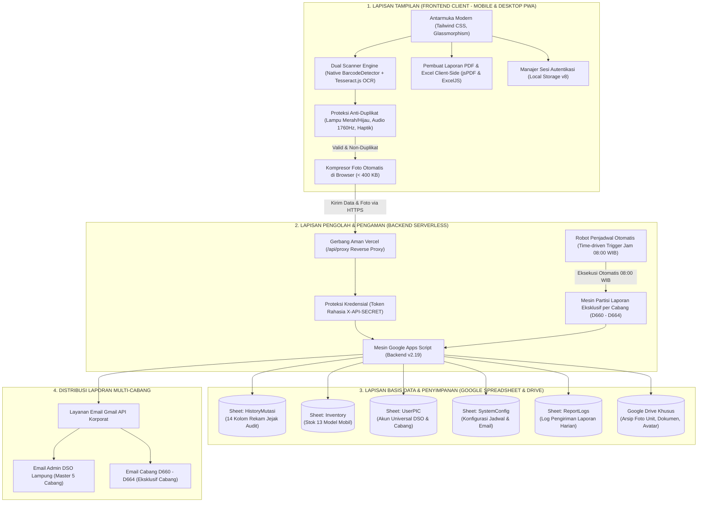
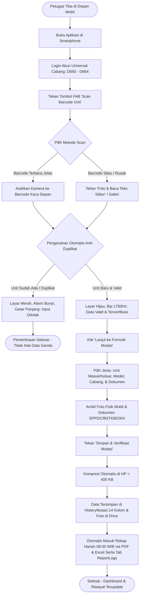

# 🚗 Dokumen Spesifikasi Produk (PRD) & Panduan Sistem Lengkap
## Sistem Management StockYard Kendaraan (Astra Daihatsu DSO Lampung)

> **Klasifikasi:** Dokumen Resmi Spesifikasi Produk, Arsitektur Sistem, Katalog Fitur Menyeluruh & Operasional Bisnis  
> **Sasaran Pembaca:** Manajemen Astra Daihatsu, Kepala Wilayah (DSO Lampung), Admin Head / Branch Manager (ADH/BM), Supervisor Logistik, Tim Security On-Duty Cabang (D660–D664), & Tim Pengembang  
> **Status Dokumen:** Siap Operasional (*Production-Ready Enterprise Edition — Versi 2.9 Terverifikasi*)  
> **Cakupan Wilayah:** Sentra Distribusi & Manajemen StockYard Area Lampung (DSO Lampung & 5 Cabang Resmi: D660, D661, D662, D663, D664)  

---

## 1. Ringkasan Eksekutif (Executive Summary)

### 1.1 Latar Belakang & Tujuan Transformasi
Operasional pengelolaan, pengawasan, dan mutasi unit kendaraan di area pool logistik dan StockYard Astra Daihatsu DSO Lampung membutuhkan kecepatan pemrosesan, akurasi data mutlak, dan pencatatan fisik yang dapat dipertanggungjawabkan secara transparan (*audit-ready*). 

Sistem **Management StockYard (Astra Daihatsu DSO Lampung)** dirancang untuk mentransformasi operasional manual berbasis kertas dan spreadsheet konvensional menjadi **ekosistem aplikasi web enterprise terpadu (Mobile & Desktop PWA)** yang terhubung secara realtime dengan infrastruktur komputasi awan Google Workspace (Google Sheets, Drive, Gmail API) melalui serverless reverse proxy Vercel berkeamanan tinggi.

### 1.2 Nilai Manfaat Utama bagi Manajemen & Operasional Cabang
* **Arsitektur Multi-Cabang Resmi (DSO Lampung & 5 Cabang D660–D664)**: Mendukung pengawasan sentral oleh Admin DSO Lampung sekaligus membatasi akses User Cabang secara independen (*data isolation*) sesuai lokasi penugasan.
* **Akun Security Universal per Cabang (Bebas NPK)**: Kredensial login cabang bersifat universal untuk setiap regu *Security on-duty*, sehingga pergantian giliran jaga berjalan lancar tanpa birokrasi input NPK perorangan.
* **Nol Risiko Data Ganda (*Zero Duplicate Entry*)**: Sistem memblokir pemindaian berulang untuk unit yang sama melalui validasi multi-sensor seketika di lapangan (audio 1760Hz, haptik, dan kunci visual).
* **Kecepatan Mutasi (< 20 Detik per Unit)**: Petugas lapangan memindai stiker barcode kaca kendaraan secara otomatis tanpa mengetik manual 17 digit nomor rangka (VIN) yang rawan keliru.
* **Bukti Fisik & Dokumen Wajib Terarsip ke Google Drive**: Setiap pergerakan mobil wajib menyertakan foto fisik unit dan foto dokumen resmi (SPPDC / BSTKB / OKK) yang langsung tersimpan rapi di Google Drive perusahaan dengan pembersihan otomatis file lama (*Drive lifecycle cleanup*).
* **Otomasi Laporan Harian Terjadwal Tepat Pukul 08:00 WIB**: Rekap mutasi 24 jam terakhir dalam format **PDF & Excel (.xlsx murni)** berkop resmi Astra Daihatsu dikompilasi dan dikirim otomatis ke email manajemen DSO serta dipartisi eksklusif ke masing-masing cabang.
* **Sinkronisasi Tab Cloud `ReportLogs` Realtime**: Setiap aktivitas pengiriman laporan harian (otomatis maupun manual via tombol "Kirim Laporan") tercatat ke tab `ReportLogs` dan tersinkronisasi 100% ke modal notifikasi aplikasi.

---

## 2. Perbandingan: Cara Kerja Konvensional vs. Sistem Baru

| Aspek Operasional | Cara Konvensional (Sebelumnya) | Menggunakan Sistem Management StockYard (v2.9) |
| :--- | :--- | :--- |
| **Pencatatan Nomor Rangka (VIN)** | Dicatat manual di kertas surat jalan atau diketik di Excel. Sering terjadi salah baca angka `0` dan huruf `O`, atau `1` dan `I`. | **Pemindaian Otomatis via Kamera Smartphone**. Dual-engine (Barcode + Tesseract OCR) mengekstrak 17 digit VIN dan nomor mesin dengan normalisasi ISO. |
| **Menghadapi Stiker Kaca Bertumpuk** | Petugas bingung karena stiker kaca Daihatsu memiliki 5-7 baris barcode bertumpuk (nomor DO, PO, suku cadang, VIN, mesin). | **Filter Cerdas Otomatis (`smartFilterBarcodes`)**. Kamera langsung mengunci VIN berawalan `MHK...` serta membuang kode pabrik yang tidak relevan. |
| **Identitas Petugas Security** | Diikat ke NPK perorangan sehingga sulit saat ganti shift atau petugas piket berganti. | **Universal Branch Account Login**. Login fleksibel per cabang untuk seluruh security bertugas tanpa perlu input NPK perorangan. |
| **Pencegahan Unit Terinput Dua Kali** | Baru ketahuan saat ada selisih stok fisik bulanan (*stock opname*). | **Pencegahan Real-Time di Lapangan**. Jika unit sudah tercatat, aplikasi seketika mengunci layar merah, menyalakan alarm nada rendah, dan menolak penyimpanan. |
| **Arsip Bukti Foto Fisik & Dokumen** | Foto tersimpan di galeri WhatsApp petugas lapangan, sering terhapus, buram, atau membebani memori ponsel. | **Terunggah Otomatis ke Google Drive Resmi**. Foto unit & dokumen (SPPDC / BSTKB / OKK) terhubung langsung dengan nomor rangka kendaraan dan dapat diakses dari laporan. |
| **Pengelolaan Foto Profil User** | Foto lama menumpuk di cloud storage hingga menghabiskan kuota Google Drive. | **Lifecycle Cleanup Otomatis**. Saat foto profil diperbarui, sistem mengunggah foto baru dan otomatis menghapus foto lama dari Google Drive. |
| **Format Laporan Harian Eksekutif** | Format Excel dan PDF sering kali berbeda susunan kolom, tanpa logo resmi, dan tanpa foto visual. | **100% Identik Berlogo Daihatsu**: PDF dan Excel memiliki 13 kolom seragam, kop Astra resmi, status terverifikasi, dan visual thumbnail tersemat rapi di sel. |
| **Distribusi Laporan Harian ke Cabang** | Satu file rekap dikirim masal; cabang melihat data unit cabang lain yang bukan wewenangnya. | **Distribusi Partisi Eksklusif**: Admin DSO menerima rekap 5 cabang (master), sedangkan tiap cabang (D660–D664) hanya menerima file mutasi eksklusif cabangnya. |

---

## 3. Struktur Organisasi Cabang & Hak Akses Berjenjang

Sistem menerapkan prinsip **Role-Based Access Control (RBAC)** terisolasi yang disesuaikan dengan hierarki operasional Astra Daihatsu Area Lampung:

```
┌────────────────────────────────────────────────────────────────────────────────────────┐
│             STRUKTUR HAK AKSES SISTEM MANAGEMENT STOCKYARD ASTRA DAIHATSU              │
├──────────────────────────────────────────┬─────────────────────────────────────────────┤
│ 1. ADMIN HEAD / BRANCH MANAGER (ADH/BM)  │ • Pengawas sentral seluruh cabang           │
│    (Sentra Lampung • Astra Daihatsu DSO) │ • Akses penuh 5 cabang (D660 s/d D664)      │
│                                          │ • Melihat, memfilter, & ekspor seluruh data │
│                                          │ • Menerima email laporan master 5 cabang    │
├──────────────────────────────────────────┼─────────────────────────────────────────────┤
│ 2. USER CABANG SECURITY (D660 s/d D664)  │ • D660 - Ahmad Yani                         │
│    (Petugas Security On-Duty per Cabang) │ • D661 - Soekarno Hatta                     │
│                                          │ • D662 - Bandar Jaya                        │
│                                          │ • D663 - Lampung Utara                      │
│                                          │ • D664 - Lampung Timur                      │
│                                          │ • Terbatas HANYA pada data cabang sendiri   │
│                                          │ • Universal login tanpa NPK perorangan      │
│                                          │ • Menerima rekap email eksklusif cabangnya  │
└──────────────────────────────────────────┴─────────────────────────────────────────────┘
```

---

## 4. Rincian Lengkap Seluruh Fitur Website

```
┌──────────────────────────────────────────────────────────────────────────────────┐
│                   PETA FITUR SISTEM MANAGEMENT STOCKYARD (v2.8)                  │
├───────────────────────────────┬──────────────────────────────────────────────────┤
│ 1. NAVIGASI & HEADER GLOBAL   │ • Status Pool Cabang, Pill Role Switcher,        │
│                               │   Dot Notifikasi, Pull-to-Refresh Mobile, FAB    │
├───────────────────────────────┼──────────────────────────────────────────────────┤
│ 2. DASHBOARD & ANALITIK       │ • Carousel 13 Model Mobil, Filter Tanggal/Bulan, │
│                               │   4 Kartu KPI Dinamis, Donut Chart, Live Feed    │
├───────────────────────────────┼──────────────────────────────────────────────────┤
│ 3. MANAJEMEN INVENTARIS STOK  │ • Ringkasan Status, Grid 13 Model, Filter Cepat, │
│                               │   Pencarian Real-Time, Tombol Drill-down         │
├───────────────────────────────┼──────────────────────────────────────────────────┤
│ 4. RINCIAN MODEL (DRILL-DOWN) │ • Banner Spesifikasi Model, Filter Mutasi Model, │
│                               │   Filter Tanggal, Tabel Rincian Unit per Model   │
├───────────────────────────────┼──────────────────────────────────────────────────┤
│ 5. RIWAYAT MUTASI & EKSPOR    │ • Log Mutasi Komprehensif, Filter Kalender,      │
│                               │   Ekspor PDF Berkop Resmi, Ekspor Excel Berfoto  │
├───────────────────────────────┼──────────────────────────────────────────────────┤
│ 6. SCANNER 2-TAHAP & FORM     │ • Dual Engine (Barcode + OCR), Senter, Reticle,  │
│                               │   Alarm Anti-Duplikat, Form Foto Unit & Dokumen  │
├───────────────────────────────┼──────────────────────────────────────────────────┤
│ 7. PUSAT NOTIFIKASI REAL-TIME │ • Indikator Live Sync, Ping Server, Tombol Kirim │
│                               │   Laporan, Sinkronisasi Cloud Tab ReportLogs     │
├───────────────────────────────┼──────────────────────────────────────────────────┤
│ 8. PENGATURAN OTOMASI LAPORAN │ • Jam Analog "Jam Bulet", Frekuensi Kirim,       │
│                               │   Multi-Email Chips Manager (> 5 Email Tujuan)   │
├───────────────────────────────┼──────────────────────────────────────────────────┤
│ 9. PENGATURAN & AKUN UNIVERSAL│ • Edit Profil (Nama, Jabatan, Cabang, Foto Drive)│
│                               │   Pembersihan Otomatis Foto Lama, Logout Sesi    │
├───────────────────────────────┼──────────────────────────────────────────────────┤
│ 10. LIGHTBOX & TOAST ALERT    │ • Penampil Foto Resolusi Penuh, Zoom & Unduh,    │
│                               │   Floating Toast Notifications (Sukses/Error)    │
└───────────────────────────────┴──────────────────────────────────────────────────┘
```

### 4.1 Navigasi Global, Header, & Gestur Mobile
1. **Lencana Status Pool Aktif (*Yard Badge*)**:
   - Menampilkan identitas cabang penugasan resmi: `D660 - Ahmad Yani` hingga `Sentra Lampung • Astra Daihatsu DSO Lampung`.
2. **Pill Role Switcher Interaktif**:
   - Menampilkan status akun saat ini (`Admin (Semua)` warna biru safir atau `User D66X` warna kuning amber).
   - Mengetuk tombol ini membuka modal autentikasi cepat untuk berpindah akun operasional secara aman.
3. **Indikator Lonceng Notifikasi & Pulse Dot**:
   - Ikon lonceng di bagian atas dengan titik merah berdenyut (*pulse dot*) yang menyala otomatis jika terdapat mutasi baru atau update status laporan.
4. **Profil Petugas di Header**:
   - Menampilkan foto avatar petugas yang tersinkronisasi dari Google Drive, nama petugas, dan jabatan resmi (`ADMIN HEAD / BRANCH MANAGER` atau `SECURITY`).
5. **Navigasi Tab Utama (Desktop & Mobile)**:
   - **Desktop Bar**: Tab navigasi atas untuk berpindah seketika antara **Dashboard**, **Inventaris**, **Riwayat**, dan **Pengaturan**.
   - **Mobile Bottom Navigation**: Bilah navigasi melayang ergonomis di bagian bawah layar smartphone.
6. **Tombol FAB Scan Melayang**:
   - Tombol bulat besar dengan animasi berpendar (*glowing pulse*) di bagian tengah bilah navigasi bawah untuk memicu kamera pemindai dari menu mana saja.
7. **Gestur Tarik Layar ke Bawah (*Pull-to-Refresh*)**:
   - Tarik layar dari atas ke bawah untuk menyegarkan dan mengambil data mutasi terbaru langsung dari Google Spreadsheet.

### 4.2 Dashboard & Analitik Real-Time
1. **Carousel Geser 13 Model Mobil**: Menampilkan visual 13 model Daihatsu, status ketersediaan *In-Yard* dan *In-Transit*, serta shortcut pemindaian.
2. **Filter Periode Terintegrasi**: Tiga dropdown (Tanggal, Bulan, Tahun) serta tombol pintas "Hari Ini" dan "Reset".
3. **Empat Kartu Ringkasan KPI Dinamis**: Total Unit Terdaftar, Unit In-Yard, Unit In-Transit, dan Mutasi Periode Terpilih.
4. **Diagram Donat Distribusi Model**: Visual interaktif persentase komposisi unit per model dengan tooltip informasi stok.
5. **Umpan Aktivitas Terkini (Live Feed)**: Menampilkan 5 transaksi mutasi mutakhir secara realtime dengan badge status masuk/keluar, VIN, model, dan waktu.

### 4.3 Manajemen Inventaris & Drill-Down Model
1. **Header Statistik Kategori**: Ringkasan armada keluarga/LCGC, SUV/Crossover, dan armada niaga komersial.
2. **Grid 13 Model Kendaraan**: Kartu visual beresolusi tinggi dengan indikator unit *In-Yard*, *In-Transit*, dan kapasitas maksimum.
3. **Filter Tab Status Ketersediaan**: Filter cepat *Semua Unit*, *Hanya In-Yard*, dan *Hanya In-Transit*.
4. **Pencarian Cepat Inventaris**: Menyaring kartu mobil seketika berdasarkan nomor rangka, nomor mesin, atau model.
5. **Halaman Khusus Rincian Model (*Drill-Down*)**: Banner spesifikasi kendaraan, kartu ringkasan stok model, filter tanggal khusus tipe tersebut, dan tabel unit terdaftar.

### 4.4 Riwayat Mutasi & Ekspor Laporan Komprehensif
1. **Tabel Log Mutasi Terintegrasi**: Catatan kronologis mutasi dengan rincian: Waktu, ID Transaksi, VIN, Nomor Mesin, Model Mobil, Tipe Mutasi, Petugas Security, Cabang Resmi, Jenis Dokumen (SPPDC / BSTKB / OKK), Foto Fisik Unit, Foto Dokumen, dan Catatan Lapangan.
2. **Filter Rentang Kalender & Pencarian Global**: Menyesuaikan audit harian, mingguan, bulanan, serta pencarian instan nomor rangka, nomor mesin, atau model.
3. **Empat Metode Ekspor Resmi**:
   - **Ekspor PDF Berkop Resmi**: Dokumen PDF landscape berlogo Daihatsu, format kode form `ADM-YARD-BA-01`, tabel 13 kolom seragam, dan 2 pengesahan tanda tangan resmi: `SECURITY (Petugas Security On-Duty)` dan `ADH / BM (Admin Head / Branch Manager)`.
   - **Ekspor Excel (.xlsx Murni) Berfoto**: Dihasilkan via `ExcelJS` langsung di browser, menyematkan visual foto unit & dokumen ke dalam sel tabel secara proporsional, border rapi, dan tanda tangan resmi.
   - **Cetak Langsung (*Print-Ready*)**: Tata letak ramah cetak A4 tanpa elemen UI browser.
   - **Email Rekapitulasi Terjadwal & On-Demand (Backend v2.19)**: Pengiriman otomatis pukul 08:00 WIB dan manual via tombol "Kirim Laporan" dengan lampiran PDF & Excel yang dipartisi eksklusif per cabang.

### 4.5 Pemindai Kamera 2-Tahap & Verifikasi Mutasi
* **Tahap 1: Viewport Kamera & Deteksi Cerdas**:
  - Bingkai laser 4 sudut dengan sakelar mode: Barcode Otomatis, OCR Teks Stiker, dan Unggah Foto dari Galeri.
  - Penyaring cerdas multi-barcode (`smartFilterBarcodes`): otomatis mengunci VIN 17 digit `MHK...` dan nomor mesin.
  - Alarm anti-duplikat multi-sensori: Jika unit terdaftar, layar menyala **MERAH**, alarm nada rendah berbunyi, ponsel bergetar panjang, dan tombol lanjut diblokir. Jika valid, layar menyala **HIJAU**, bunyi bip 1760Hz, dan tombol lanjut aktif.
* **Tahap 2: Formulir Serah Terima Mutasi Unit**:
  - Banner identitas nomor sasis dan mesin terkunci.
  - Pilihan radio: **Unit Masuk** atau **Unit Keluar**.
  - Dropdown 13 Model Resmi Kendaraan Daihatsu.
  - Dropdown 5 Cabang Resmi: D660 - Ahmad Yani, D661 - Soekarno Hatta, D662 - Bandar Jaya, D663 - Lampung Utara, D664 - Lampung Timur.
  - Dropdown Dokumen Resmi: **SPPDC**, **BSTKB**, atau **OKK**.
  - Dua slot foto wajib: Foto Fisik Mobil dan Foto Dokumen (SPPDC / BSTKB / OKK).
  - Kolom catatan kondisi lapangan & tombol simpan berindikator kompresi gambar.

### 4.6 Pusat Notifikasi & Sinkronisasi Cloud (`ReportLogs`)
* **Live Status Koneksi**: Indikator koneksi realtime ke backend Google Apps Script.
* **Tombol Kirim Laporan On-Demand**: Memicu pengiriman laporan harian ke email manajemen seketika.
* **Filter Riwayat Notifikasi**:
  - `Semua (N)`: Menggabungkan seluruh mutasi unit dan riwayat pengiriman laporan.
  - `Masuk (N)`: Mutasi unit masuk.
  - `Keluar (N)`: Mutasi unit keluar.
  - `Laporan (N)`: Catatan resmi berkas laporan rekapitulasi harian yang berhasil dikirimkan ke email target, tersinkronisasi langsung dari tab spreadsheet **`ReportLogs`**.
* **Kartu Laporan Harian Modern**: Memuat badge `📄 Laporan Rekap Harian`, tanggal periode laporan, jumlah unit (masuk/keluar), status `Spreadsheet Sync ✓` / `Email Terkirim ✓`, serta rincian chip email penerima.

### 4.7 Pengaturan Akun Universal & Manajemen Profil
* **Akun Universal Cabang Bebas NPK**: Petugas tidak dibebani input NPK, hanya nama lengkap petugas bertugas, cabang penugasan, dan jabatan.
* **Penggantian Foto Profil & Otomasi Google Drive**:
  - Mengunggah foto profil baru langsung menyimpan file ke Google Drive perusahaan.
  - Sistem secara cerdas menghapus foto lama dari Google Drive saat foto baru berhasil tersimpan (*Drive storage optimization*).
* **Persistensi Sesi Autentikasi**: Status login tersimpan aman di `localStorage` (`daihatsu_auth_session_v8`), sehingga saat halaman di-reload aplikasi tidak kembali ke akun lama.

---

## 5. Arsitektur Tiga Lapis (Frontend, Backend, & Database)



---

## 6. Spesifikasi Lengkap Basis Data (Google Sheets & Drive)

Struktur tabel di Google Spreadsheet dirancang rapi, mudah dibaca langsung oleh manajemen, dan sinkron dengan sistem:

### 6.1 Lembar Kerja 1: `HistoryMutasi` (Buku Besar Rekam Jejak — 14 Kolom Resmi)
| Kolom | Nama Kolom Spreadsheet | Tipe Data | Contoh Isi Data | Penjelasan Fungsi Data |
| :---: | :--- | :--- | :--- | :--- |
| **A** | `ID Mutasi` | Teks Unik | `MUT-20261027-083015` | Nomor urut kode transaksi mutasi |
| **B** | `Timestamp ISO` | ISO String | `2026-10-27T01:30:15.000Z` | Stempel waktu standar sistem |
| **C** | `Tanggal` | Tanggal | `27/10/2026` | Tanggal mutasi di lapangan |
| **D** | `Jam` | Waktu | `08:30 WIB` | Jam serah terima unit di pool |
| **E** | `Model` | Teks Pilihan | `Gran Max Pick Up` | Varian model dari 13 katalog Daihatsu |
| **F** | `No. Rangka (VIN)` | Teks (17 Digit) | `MHKP3FA1JTK137533` | Nomor rangka resmi (Kunci Utama) |
| **G** | `No. Mesin` | Teks | `2NR4F82393` | Nomor mesin kendaraan |
| **H** | `Jenis Mutasi` | Teks | `Unit Masuk` / `Unit Keluar` | Jenis pergerakan kendaraan |
| **I** | `Petugas PIC` | Teks | `SECURITY - D660` | Identitas petugas security bertugas |
| **J** | `Cabang / Kode BA` | Teks | `D660 - Ahmad Yani` | Cabang resmi penugasan (D660–D664) |
| **K** | `Catatan` | Teks Catatan | `Kondisi mulus, spion lengkap` | Catatan kondisi fisik unit |
| **L** | `SPPDC / BSTKB / OKK` | Teks | `SPPDC` | Jenis dokumen serah terima |
| **M** | `Foto Unit` | Tautan URL Drive | `https://drive.google.com/file/d/...` | Foto fisik unit kendaraan |
| **N** | `Foto Dokumen` | Tautan URL Drive | `https://drive.google.com/file/d/...` | Foto fisik dokumen surat jalan |

> [!NOTE]
> Kolom **NPK** telah dihapus secara resmi dari `HistoryMutasi`. Backend dilengkapi deteksi dinamis header: jika kolom NPK masih ada di spreadsheet lama, backend mengisi `-`; jika kolom NPK sudah dihapus, backend langsung mengisi 14 kolom secara presisi tanpa pergeseran kolom.

### 6.2 Lembar Kerja 2: `Inventory` (Status Stok per Model)
| Kolom | Nama Kolom | Tipe Data | Contoh Isi Data | Penjelasan |
| :---: | :--- | :--- | :--- | :--- |
| **A** | `ID Model` | Teks | `MOD-001` | Kode model kendaraan |
| **B** | `Model Kendaraan` | Teks | `Rocky e-Smart Hybrid` | Nama varian resmi |
| **C** | `Kategori` | Teks | `Smart Hybrid SUV` | Segmen pasar armada |
| **D** | `Stok In-Yard` | Angka | `14` | Jumlah mobil yang ada di pool |
| **E** | `Kapasitas Maks` | Angka | `25` | Kapasitas parkir model tersebut |

### 6.3 Lembar Kerja 3: `UserPIC` (Akun Pengguna Universal)
| Kolom | Nama Kolom | Tipe Data | Contoh Isi | Penjelasan |
| :---: | :--- | :--- | :--- | :--- |
| **A** | `ID User` | Teks | `USR-001` / `SEC-D660` | Kode identitas sistem |
| **B** | `Username` | Teks | `DSO LAMPUNG` / `D660` | Username login universal |
| **C** | `Password` | Teks | `daihatsu2026` | Kredensial autentikasi |
| **D** | `Nama Lengkap` | Teks | `ADMIN HEAD / BRANCH MANAGER` | Nama tampilan pejabat/regu |
| **E** | `Cabang` | Teks | `Sentra Lampung` / `D660 - Ahmad Yani` | Wilayah wewenang kerja |
| **F** | `Jabatan` | Teks | `ADMIN HEAD / BRANCH MANAGER` / `SECURITY` | Peran operasional |
| **G** | `Target Email` | Teks | `email.resmi@cabang.daihatsu.co.id` | Email koordinasi cabang |
| **H** | `Foto Profil` | Tautan URL | `https://drive.google.com/...` | URL foto profil aktif di Drive |
| **I** | `Status` | Teks | `Aktif` | Status keaktifan akun |
| **J** | `Terakhir Login` | Waktu | `27/10/2026 08:15:20 WIB` | Stempel waktu login terakhir |

### 6.4 Lembar Kerja 4: `ReportLogs` (Riwayat Pengiriman Laporan Harian)
| Kolom | Nama Kolom | Tipe Data | Contoh Isi Data | Penjelasan |
| :---: | :--- | :--- | :--- | :--- |
| **A** | `ID Laporan` | Teks | `REP-20261027-080005` | Nomor transaksi pengiriman laporan |
| **B** | `Timestamp ISO` | ISO String | `2026-10-27T01:00:05.000Z` | Waktu eksekusi laporan |
| **C** | `Waktu Kirim` | Teks | `27/10/2026 08:00 WIB` | Jam pengiriman laporan resmi |
| **D** | `Periode Laporan` | Teks | `26/10/2026` | Tanggal mutasi yang direkap |
| **E** | `Target Email Penerima` | Teks | `email.resmi@cabang.daihatsu.co.id, ...` | Seluruh email yang menerima laporan |
| **F** | `Total Unit` | Angka | `13` | Total mutasi yang dilaporkan |
| **G** | `Unit Masuk` | Angka | `12` | Jumlah unit masuk |
| **H** | `Unit Keluar` | Angka | `1` | Jumlah unit keluar |
| **I** | `Lampiran Berkas` | Angka | `2` | Jumlah berkas (PDF & Excel) |
| **J** | `Status` | Teks | `SUCCESS` | Status pengiriman email Gmail API |
| **K** | `Keterangan` | Teks | `Laporan rekapitulasi mutasi berhasil...` | Catatan eksekusi sistem |
| **L** | `Cabang Terkait` | Teks | `ALL` / `D660` | Sasaran cabang laporan |

---

## 7. Format Dokumen Laporan Resmi (PDF & Excel 100% Identik)

Berkas laporan PDF dan Excel (.xlsx) dibuat dengan format kop surat dan struktur data yang **100% konsisten**:

```
┌────────────────────────────────────────────────────────────────────────────────────────┐
│  [LOGO DAIHATSU]   PT ASTRA INTERNATIONAL Tbk — DAIHATSU SALES OPERATION               │
│  (Base64 Resmi)    Sentra Distribusi & Manajemen StockYard Area Lampung                │
│                    KODE FORM: ADM-YARD-BA-01 • Astra Daihatsu DSO Lampung               │
├────────────────────────────────────────────────────────────────────────────────────────┤
│  ══════════════════════ [Garis Aksen: Merah 54% & Navy 46%] ═════════════════════════  │
│                                                                                        │
│               REPORT REKAPITULASI MUTASI HARIAN KENDARAAN (STOCKYARD)                  │
│                                                                                        │
│  [🏢 CABANG: D660 - AHMAD YANI]   [📅 PERIODE: 26/10/2026]   [🕒 CETAK: 08:00 WIB]    │
├────┬──────────┬───────┬─────────┬──────────┬────────┬──────────┬────────┬───────┬──────┤
│ No │ID Mutasi │ Waktu │ Tanggal │  Model   │ Cabang │No Rangka │No Mesin│ Jenis │Petugas│
│    │          │       │         │Kendaraan │        │  (VIN)   │        │Mutasi │Secur. │
├────┼──────────┼───────┼─────────┼──────────┼────────┼──────────┼────────┼───────┼──────┤
│ 1  │MUT-001   │08:15  │26/10/26 │Terios SE │D660    │MHKP3...  │2NR...  │ MASUK │Sec D0│
├────┴──────────┴───────┴─────────┴──────────┴────────┴──────────┴────────┴───────┴──────┤
│ TOTAL REKAPITULASI MUTASI KENDARAAN: 13 Unit  |  MASUK: 12 Unit  |  KELUAR: 1 Unit     │
├────────────────────────────────────────────────────┬───────────────────────────────────┤
│           Petugas Pemeriksa & Pemindai:            │      Mengetahui & Menyetujui:     │
│                     SECURITY                       │ ADH / BM (ADMIN HEAD / BRANCH MGR)│
│                                                    │                                   │
│           ( Petugas Security On-Duty )             │   ( Admin Head / Branch Manager ) │
│        Reg. Security Guard • Astra Daihatsu        │     Astra Daihatsu DSO Lampung    │
└────────────────────────────────────────────────────┴───────────────────────────────────┘
```

### 13 Kolom Seragam Tabel PDF & Excel:
1. `No` — Nomor Urut
2. `ID Mutasi` — Nomor Registrasi Transaksi
3. `Waktu` — Jam Mutasi di Lapangan (WIB)
4. `Tanggal` — Tanggal Transaksi Mutasi
5. `Model Kendaraan` — Varian Resmi dari 13 Model Daihatsu
6. `Cabang` — Kode & Nama Cabang (D660 s/d D664)
7. `No. Rangka (VIN)` — 17 Digit Nomor Sasis (Font Monospace)
8. `No. Mesin` — Nomor Mesin Kendaraan
9. `Jenis Mutasi` — Lencana Hijau (`Unit Masuk`) atau Biru (`Unit Keluar`)
10. `Petugas Security` — Identitas Petugas On-Duty Cabang
11. `Catatan` — Catatan Kondisi Fisik Lapangan
12. `Foto Fisik Unit` — Visual Gambar / Tautan Langsung Google Drive
13. `Foto Dokumen` — Visual Berkas Dokumen (SPPDC / BSTKB / OKK) / Tautan Langsung Google Drive

---

## 8. Katalog 13 Model Resmi Kendaraan Daihatsu

| No | Nama Model Kendaraan | Kategori Segmen | Karakteristik Penggunaan Lapangan |
| :-: | :--- | :--- | :--- |
| **1** | **All New Ayla** | Hatchback / LCGC | Area parkir *city car* / *compact yard* |
| **2** | **New Sigra** | MPV 7-Seater / LCGC | Unit volume tinggi, distribusi keluarga |
| **3** | **All New Xenia** | MPV Keluarga | Mobil keluarga multifungsi, perputaran unit tinggi |
| **4** | **New Terios** | Compact SUV | Unit petualang / medium ground clearance |
| **5** | **Terios Special Edition (SE)**| Compact SUV Khusus | Unit edisi terbatas dengan aksesoris khusus |
| **6** | **New Rocky** | Compact Crossover | Unit SUV turbo compact modern |
| **7** | **Rocky ADS** | Crossover Sporty | Edisi sporty paket bodi Astra Daihatsu Styling |
| **8** | **Rocky e-Smart Hybrid** | Crossover Elektrik/Hybrid | Penanganan khusus unit berteknologi baterai/hybrid |
| **9** | **New Sirion** | City Car Premium | Hatchback premium perkotaan |
| **10**| **Gran Max Pick Up** | Niaga Komersial Ringan | Armada angkutan barang terbuka, frekuensi mutasi tinggi |
| **11**| **Gran Max Blind Van** | Niaga Kargo Tertutup | Armada kargo tertutup untuk ekspedisi dan logistik |
| **12**| **Gran Max Minibus** | Niaga Penumpang / Travel | Armada angkutan penumpang umum / travel |
| **13**| **Daihatsu Luxio** | Minibus Eksekutif | Kendaraan komersial premium berkapasitas lega |

---

## 9. Alur Kerja Operasional Petugas Lapangan (SOP Ringkas)



---

## 10. Keamanan Sistem, Privasi Data, & Kepatuhan Korporat

1. **Pencegahan Kebocoran Kredensial (Zero Public Secrets)**:
   - Tidak ada berkas Google Apps Script (`.gs`) yang terbuka di repositori publik.
   - Variabel lingkungan rahasia (`APPSCRIPT_URL`, `API_SECRET_TOKEN`) dilindungi di balik reverse proxy Vercel (`/api/proxy`).
2. **Koneksi Terenkripsi Penuh (SSL/TLS 256-Bit)**:
   - Seluruh komunikasi dari perangkat lapangan ke cloud dijamin oleh protokol HTTPS.
3. **Pemisahan Hak Akses & Isolasi Data Cabang**:
   - Cabang D660 hingga D664 hanya dapat mengakses dan menerima data cabangnya sendiri.
   - Admin DSO Lampung memegang hak pengawasan menyeluruh terhadap 5 cabang.
4. **Manajemen Penyimpanan Google Drive Otomatis**:
   - Mengunggah foto profil baru memicu penghapusan foto profil lama secara otomatis untuk mencegah penumpukan sampah digital dan menjaga kuota penyimpanan cloud perusahaan.

---

## 11. Pengesahan & Kontak Dukungan Layanan

Dokumen spesifikasi produk dan cetak biru sistem ini merupakan panduan operasional dan teknis resmi bagi seluruh pemangku kepentingan Astra Daihatsu DSO Lampung:

* **Penanggung Jawab Sistem:** Tim Sistem Informasi & Manajemen StockYard Astra Daihatsu DSO Lampung  
* **Pusat Operasional:** Pool StockYard Sentra Lampung (Astra Daihatsu DSO Lampung)  
* **Cabang Terdaftar:** D660 (Ahmad Yani), D661 (Soekarno Hatta), D662 (Bandar Jaya), D663 (Lampung Utara), D664 (Lampung Timur)  
* **Email Dukungan Resmi:** `admin.logistics@daihatsu.co.id`  
* **Status Dokumen:** Disetujui untuk Operasional Penuh (*Versi 2.9 Enterprise Edition — Terverifikasi*)  


