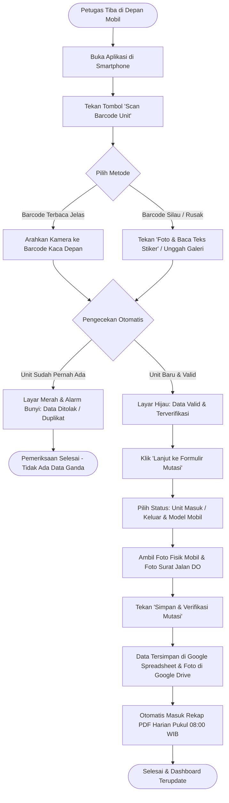

# 🚗 Dokumen Spesifikasi Produk (PRD) & Panduan Sistem
## Sistem Management StockYard Kendaraan (Astra Daihatsu DSO Lampung)

> **Klasifikasi:** Dokumen Resmi Spesifikasi Produk & Operasional Bisnis  
> **Sasaran Pembaca:** Manajemen, Kepala Operasional Pool, Supervisor Logistik, & Petugas Lapangan  
> **Status:** Siap Operasional (*Production-Ready*)  
> **Lokasi Implementasi:** Pool StockYard Sentra Lampung (Astra Daihatsu DSO Lampung)  

---

## 1. Ringkasan Eksekutif (Executive Summary)

### 1.1 Latar Belakang & Tujuan
Operasional pengelolaan dan penataan unit kendaraan di area pool logistik dan StockYard Astra Daihatsu DSO Lampung membutuhkan kecepatan, ketelitian mutlak, dan pencatatan fisik yang dapat dipertanggungjawabkan (*audit-ready*). 

Sistem **Management StockYard (Astra Daihatsu DSO Lampung)** dirancang khusus untuk memodernisasi proses pencatatan manual berbasis kertas atau spreadsheet mandiri menjadi **sistem digital berbasis smartphone (Mobile Web)** yang terintegrasi secara langsung dengan ekosistem penyimpanan awan (*cloud*) Google Workspace yang aman, praktis, dan hemat biaya.

### 1.2 Nilai Manfaat Utama bagi Manajemen & Klien
* **Nol Risiko Data Ganda (*Zero Duplicate Entry*)**: Sistem secara cerdas memblokir pemindaian berulang untuk unit yang sama, memastikan data inventaris di lapangan selalu 100% akurat sesuai kondisi fisik sebenarnya.
* **Proses Masuk/Keluar Super Cepat (< 20 Detik per Unit)**: Petugas lapangan cukup mengarahkan kamera smartphone ke stiker kaca mobil tanpa perlu mengetik manual 17 digit nomor rangka yang rawan salah ketik.
* **Bukti Fisik Lengkap & Otomatis Terarsip**: Setiap mutasi unit wajib menyertakan foto fisik mobil dan foto surat jalan (DO) yang otomatis tersimpan rapi di Google Drive perusahaan.
* **Transparansi Tanpa Repot**: Laporan mutasi harian berformat PDF resmi terkirim otomatis ke email manajemen setiap pagi pukul **08:00 WIB**, tanpa perlu ada admin yang lembur merekap manual.
* **Akses Mudah Tanpa Instalasi Rumit**: Aplikasi dapat langsung dibuka melalui browser di smartphone Android maupun iPhone tanpa perlu install aplikasi berat dari toko aplikasi.

---

## 2. Perbandingan: Cara Kerja Konvensional vs. Sistem Baru

| Aspek Operasional | Cara Konvensional (Sebelumnya) | Menggunakan Sistem Management StockYard |
| :--- | :--- | :--- |
| **Pencatatan Nomor Rangka (VIN)** | Dicatat tangan di kertas surat jalan atau diketik satu per satu di Excel. Sering terjadi salah baca angka `0` dan huruf `O`, atau `1` dan `I`. | **Pemindaian Otomatis via Kamera Smartphone**. Sistem langsung mengekstrak nomor rangka 17 digit dan nomor mesin dengan verifikasi standar ISO otomotif. |
| **Menghadapi Stiker Kaca Bertumpuk** | Petugas bingung karena stiker kaca Daihatsu memiliki 5-7 barcode bertumpuk (nomor vendor, barcode DO, nomor sasis, barcode suku cadang). | **Filter Cerdas Otomatis**. Kamera pintar langsung menyaring dan memilih nomor rangka berawalan `MHK` dan mengabaikan kode pabrik yang tidak diperlukan. |
| **Pencegahan Unit Terinput Dua Kali** | Baru ketahuan saat ada selisih stok fisik bulanan (*stock opname*). | **Pencegahan Real-Time di Lapangan**. Jika unit sudah tercatat, aplikasi langsung berbunyi peringatan, bergetar panjang, dan layar memblokir tombol simpan. |
| **Arsip Bukti Foto Fisik & Surat Jalan** | Foto tersimpan di galeri WhatsApp petugas lapangan, sering terhapus, buram, atau tercecer. | **Terunggah Otomatis ke Google Drive Resmi**. Foto langsung terhubung dengan nomor rangka kendaraan dan dapat dibuka kapan saja melalui link di laporan. |
| **Laporan Harian ke Pihak Manajemen** | Admin pool harus mengetik rekap manual setiap sore atau pagi hari, rentan terlambat. | **Otomatis Kirim PDF ke Email Jam 08:00 WIB**. Sistem bekerja mandiri merekap mutasi 24 jam terakhir dan melampirkannya dalam format PDF siap cetak. |

---

## 3. Fitur Unggulan Sistem (System Core Features)

```
┌─────────────────────────────────────────────────────────────────────────────┐
│             EKOSISTEM MANAGEMENT STOCKYARD (ASTRA DAIHATSU)                 │
├──────────────────────┬───────────────────────────────┬──────────────────────┤
│  1. PINTAR DI LAPANGAN│     2. PENGAMANAN DATA        │ 3. LAPORAN OTOMATIS  │
│  • Scan Kamera Cepat │  • Validasi Anti-Duplikat     │ • Rekap PDF 08:00 WIB│
│  • Baca Teks OCR     │  • Data ke Google Sheets      │ • Kirim Email Harian │
│  • Pilihan 13 Model  │  • Foto Rapi di Google Drive  │ • Dashboard Stok Yard│
│  • Wajib Foto Unit/DO│  • Proteksi Gerbang Server    │ • Pantauan Real-Time │
└──────────────────────┴───────────────────────────────┴──────────────────────┘
```

### 3.1 Pemindai Cerdas 2-Mode (Smart Scanner)
Dirancang untuk kondisi lapangan yang dinamis (terik matahari, kaca mobil melengkung, stiker sedikit kotor):
1. **Mode Barcode Otomatis**: Cukup arahkan kamera ke stiker kaca depan, sistem langsung membaca barcode nomor rangka secara instan dalam hitungan milidetik.
2. **Mode Baca Teks Stiker (OCR)**: Jika barcode rusak, robek, atau terkena pantulan sinar matahari, petugas cukup menekan tombol *"Foto & Baca Teks Stiker"*. Sistem akan membaca tulisan cetak di bawah barcode dan mengisi nomor sasis dan mesin secara otomatis. Petugas juga bisa memilih foto stiker dari galeri ponsel.

### 3.2 Proteksi Anti-Duplikasi Multi-Sensor
Untuk memastikan tidak ada data ganda, sistem dilengkapi alarm sensorik yang langsung dipahami petugas di lapangan:
* **Jika Data Baru / Valid**: Terdengar bunyi *bip* nada tinggi, getaran pendek di tangan, kotak pemindai terkunci hijau, dan muncul tanda hijau **"TERVERIFIKASI"**.
* **Jika Data Sudah Pernah Masuk (Duplikat)**: Terdengar nada alarm peringatan rendah, getaran panjang di smartphone, kotak pemindai menyala **MERAH**, dan formulir otomatis terkunci agar tidak tersimpan ganda.

### 3.3 Formulir Serah Terima 2-Tahap (2-Step Progressive Handover)
* **Tahap 1 (Verifikasi Identitas)**: Memastikan nomor sasis (VIN 17 digit) dan nomor mesin valid dan terbukti belum pernah didata ganda.
* **Tahap 2 (Kelengkapan Dokumen & Fisik)**:
  - Memilih jenis mutasi: **Unit Masuk** (Penerimaan dari pabrik/vendor) atau **Unit Keluar** (Pengiriman ke dealer/ekspedisi/penjualan).
  - Memilih model kendaraan dari **13 Model Resmi Daihatsu**.
  - Mengambil foto fisik kendaraan langsung dari kamera.
  - Mengambil foto surat jalan / delivery order (DO) fisik.
  - Menuliskan catatan kondisi (misalnya: *baret halus di bemper kiri, kunci cadangan lengkap*).

### 3.4 Dashboard Pemantauan Stok Real-Time
* **Statistik Cepat**: Menampilkan Total Unit, Unit Tersedia di Pool (*In-Yard*), Unit dalam Pengiriman (*In-Transit*), dan Mutasi Hari Ini.
* **Distribusi 13 Model Kendaraan**: Pemantauan jumlah unit per tipe mobil (Ayla, Sigra, Xenia, Terios, Gran Max, Rocky, Luxio, Sirion, dll.).
* **Katalog Visual Interaktif**: Dilengkapi banner visual interaktif yang menampilkan foto dan data pergerakan masing-masing model kendaraan.
* **Pencarian Cepat & Filter**: Memudahkan pencarian unit berdasarkan nomor rangka, nomor mesin, model mobil, atau nama petugas penanggung jawab.

### 3.5 Sistem Notifikasi & Laporan PDF Otomatis
* **Laporan Mutasi Harian Setiap 08:00 WIB**: Setiap hari, sistem secara otomatis merangkum semua kendaraan yang masuk dan keluar dalam 24 jam terakhir, mengubahnya menjadi dokumen PDF resmi, lalu mengirimkannya ke alamat email manajemen.
* **Indikator Konektivitas Real-Time**: Pada layar aplikasi terdapat indikator status apakah koneksi sistem dan layanan email aktif, memberikan rasa tenang kepada petugas bahwa data yang diinput pasti sampai ke tujuan.

---

## 4. Alur Kerja Operasional Petugas Lapangan (SOP Ringkas)

Berikut adalah tahapan praktis penggunaan aplikasi oleh petugas di pool logistik:



---

## 5. Katalog 13 Model Resmi Kendaraan Daihatsu

Sistem telah diprogram mengenali dan mengelompokkan 13 varian model resmi kendaraan Daihatsu yang beredar di pasar:

| No | Nama Model Kendaraan | Kategori Segmen | Karakteristik Penggunaan Lapangan |
| :-: | :--- | :--- | :--- |
| **1** | **All New Ayla** | Hatchback / LCGC | Penempatan di area parkir city car / compact yard |
| **2** | **New Sigra** | MPV 7-Seater / LCGC | Unit volume tinggi, fast-moving distribusi keluarga |
| **3** | **All New Xenia** | MPV Keluarga | Mobil keluarga multifungsi, perputaran unit tinggi |
| **4** | **New Terios** | Compact SUV | Unit petualang / medium ground clearance |
| **5** | **Terios Special Edition (SE)**| Compact SUV Khusus | Unit edisi terbatas dengan aksesoris khusus |
| **6** | **New Rocky** | Compact Crossover | Unit SUV turbo compact modern |
| **7** | **Rocky ADS** | Crossover Sporty | Edisi sporty dengan paket bodykit Astra Daihatsu Styling |
| **8** | **Rocky Hybrid** | Crossover Elektrik/Hybrid | Penanganan khusus unit berteknologi baterai/hybrid |
| **9** | **New Sirion** | City Car Premium | Hatchback premium perkotaan |
| **10**| **Gran Max Pick Up** | Niaga Komersial Ringan | Armada angkutan barang terbuka, frekuensi mutasi tinggi |
| **11**| **Gran Max Blind Van** | Niaga Kargo Tertutup | Armada tertutup untuk ekspedisi dan kargo logistik |
| **12**| **Gran Max Minibus** | Niaga Penumpang / Travel | Armada angkutan penumpang umum / travel |
| **13**| **Daihatsu Luxio** | Minibus Eksekutif | Kendaraan komersial premium berkapasitas lega |

---

## 6. Penyimpanan Data & Format Laporan (Mudah Diaudit)

Untuk kemudahan klien dan manajemen non-programmer, seluruh data disimpan pada platform yang sangat familiar dan transparan:

### 6.1 Database Google Spreadsheet
Manajemen tidak perlu membuka software rumit atau query database SQL. Cukup buka link Google Spreadsheet resmi milik perusahaan:
1. **Lembar `Mutasi_Logistik` (Buku Rekam Jejak Mutasi)**:
   - Mencatat setiap kejadian mutasi secara urut waktu (*Waktu, ID Mutasi, No. Rangka 17 Digit, No. Mesin, Model Mobil, Status Masuk/Keluar, Nama Petugas PIC, No. Surat Jalan DO, Link Foto Mobil, Link Foto Dokumen, Catatan Fisik*).
2. **Lembar `Inventory_Stok` (Status Terkini Setiap Unit)**:
   - Menampilkan posisi dan status setiap kendaraan saat ini: apakah unit sedang berada di pool (**IN_YARD**) atau sedang dalam perjalanan/pengiriman (**IN_TRANSIT**).
3. **Lembar `Master_PIC` (Daftar Petugas Resmi)**:
   - Mencatat akun resmi petugas lapangan yang berhak melakukan pemindaian dan mutasi.

### 6.2 Penyimpanan Foto Bukti Fisik di Google Drive
* Semua foto fisik mobil dan foto surat jalan DO otomatis tersimpan dalam folder khusus di Google Drive perusahaan.
* Nama file foto otomatis dinamai secara teratur dan seragam:  
  - Foto Mobil: `UNIT_[NomorRangka]_[Waktu].jpg`  
  - Foto Surat Jalan: `DO_[NomorRangka]_[Waktu].jpg`  
* Tautan (*link*) langsung ke foto disertakan di dalam tabel spreadsheet sehingga manajemen cukup klik link untuk langsung melihat bukti fotonya.

### 6.3 Laporan PDF Otomatis via Email
* **Jadwal Pengiriman**: Setiap hari tepat pukul **08:00 WIB**.
* **Penerima**: Alamat email resmi manajemen logistik/supervisor.
* **Isi Laporan**:
  - Ringkasan eksekutif mutasi 24 jam terakhir.
  - Jumlah total unit masuk dan unit keluar.
  - Rincian stok unit yang tersedia di pool berdasarkan 13 model mobil.
  - Tabel rincian lengkap nomor rangka, nomor mesin, dan nomor surat jalan yang diproses.

---

## 7. Keamanan Sistem & Perlindungan Privasi Data

Meskipun sistem ini sangat mudah digunakan di lapangan, keamanan data tingkat korporat tetap menjadi prioritas utama:

1. **Kode Rahasia Tidak Terekspos ke Publik**:
   - Sistem backend menggunakan mekanisme serverless yang aman. Kredensial rahasia, token, dan skrip internal Google dilindungi di balik pintu gerbang terenkripsi (*Reverse Proxy*).
   - Berkas skrip backend tidak pernah diletakkan di tempat terbuka yang dapat diakses oleh pihak luar.
2. **Akses Kamera Aman (HTTPS Terenkripsi)**:
   - Seluruh komunikasi data dari browser petugas ke database terlindungi enkripsi standar SSL/TLS 256-bit.
3. **Pemberian Hak Akses Terbatas (Role-Based Access)**:
   - Petugas lapangan hanya memiliki akses untuk memindai dan memasukkan data.
   - Pihak manajemen dan supervisor memiliki akses penuh untuk meninjau spreadsheet, folder foto Google Drive, dan menerima email PDF harian.

---

## 8. Target Kinerja & Jaminan Mutu (SLA & Key Performance Indicators)

| Indikator Kinerja (KPI) | Target Standar | Manfaat Nyata di Lapangan |
| :--- | :---: | :--- |
| **Tingkat Kesalahan Data Ganda (*Duplicate Rate*)** | **0% (Nol Kesalahan)** | Tidak akan ada unit yang terhitung ganda dalam laporan stok fisik. |
| **Kecepatan Input per Kendaraan** | **< 20 Detik** | Petugas dapat menyelesaikan input 1 mobil lengkap dengan 2 foto dalam kurang dari setengah menit. |
| **Akurasi Pemindaian Nomor Rangka** | **> 98%** | Kamera mengenali nomor rangka dan nomor mesin tanpa perlu input manual. |
| **Ketersediaan Bukti Foto Fisik** | **100% Wajib** | Tidak ada kendaraan yang masuk atau keluar tanpa memiliki foto mobil dan foto surat jalan. |
| **Ketepatan Waktu Laporan Harian** | **Tepat Pukul 08:00 WIB** | Manajemen selalu menerima laporan di meja kerja setiap pagi secara otomatis. |

---

## 9. Pertanyaan yang Sering Diajukan (FAQ) untuk Tim Lapangan

> [!NOTE]
> **T: Bagaimana jika stiker kaca depan mobil terkena pantulan sinar matahari yang silau atau kotor?**  
> **J:** Petugas cukup beralih ke tombol **"🔤 Baca Teks Stiker (OCR)"**. Sistem secara otomatis akan mempertajam kontras gambar dan membaca teks nomor rangka di bawah garis barcode. Petugas juga dapat memotret stiker terlebih dahulu, lalu memilih fotonya dari galeri smartphone.

> [!TIP]
> **T: Apakah petugas lapangan perlu membuat akun Google baru untuk menggunakan aplikasi ini?**  
> **J:** Tidak perlu. Aplikasi berbasis web ini dapat langsung diakses melalui tautan web di browser smartphone (Chrome atau Safari). Petugas cukup memilih nama mereka saat melakukan verifikasi mutasi.

> [!IMPORTANT]
> **T: Jika jaringan internet di pool tiba-tiba lambat atau terputus sementara, apakah data hilang?**  
> **J:** Sistem dirancang memiliki memori cadangan lokal sementara di browser smartphone (*Local Storage*). Jika koneksi terputus saat proses pengiriman, petugas akan diberi tahu melalui notifikasi peringatan agar dapat mencoba kembali saat sinyal kembali stabil tanpa harus memindai ulang dari awal.

---

## 10. Pengesahan & Kontak Layanan

Dokumen spesifikasi produk ini disusun untuk menjadi acuan bersama antara tim pengembang, pihak manajemen logistik, dan pengguna operasional StockYard Astra Daihatsu DSO Lampung.

* **Penanggung Jawab Sistem:** Tim Sistem Informasi & Manajemen StockYard Astra Daihatsu DSO Lampung  
* **Email Dukungan Resmi:** `admin.logistics@daihatsu.co.id`  
* **Pusat Operasional:** Pool StockYard Sentra Lampung (Astra Daihatsu DSO Lampung)  
* **Status Dokumen:** Disetujui untuk Operasional Aktif (Versi 2.4 - Terverifikasi)  
 